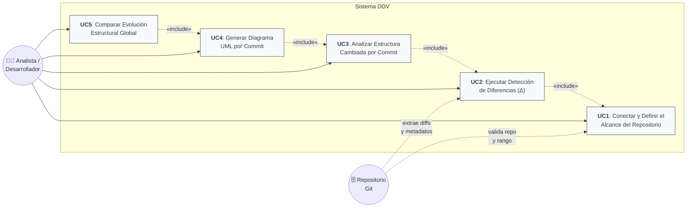
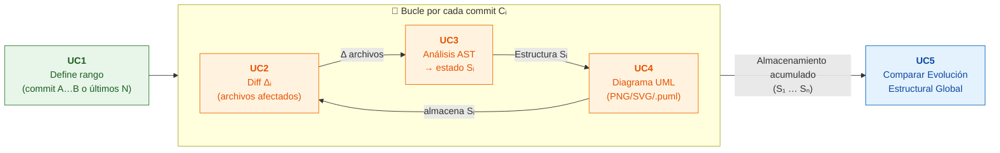
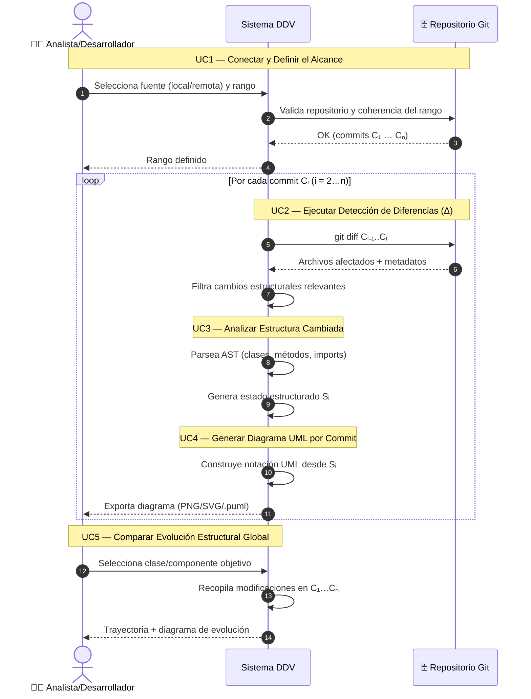
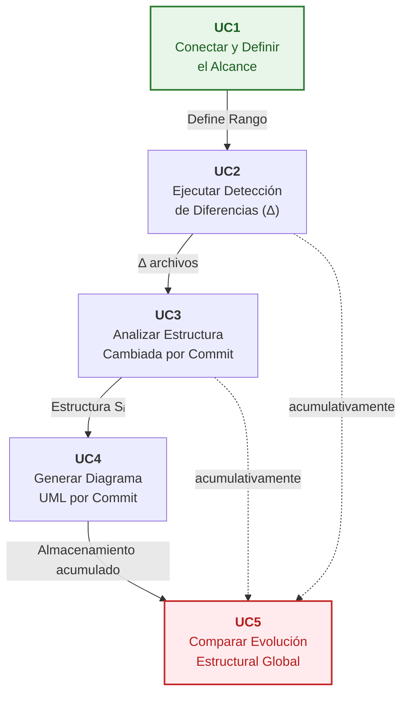

# Diagrama de Casos de Uso — DDV (Detección de Diferencias Versionadas)

**Documento de referencia de los casos de uso** del alcance MVP: aquí viven el
alcance, los actores, las definiciones y las dependencias de UC1–UC5. Las
reglas de trabajo del agente están en `AGENTS.md` (§ Reglas).

> 📏 **Regla (AGENTS.md § Reglas):** todos los diagramas de este proyecto se generan en sintaxis **Mermaid** para ser visualizados directamente en el navegador/GitHub, sin herramientas externas de renderizado.

---

## 0. Alcance MVP

Basado en el alcance del Producto Mínimo Viable —que se centra en analizar cambios estructurales simples (clases, métodos y dependencias directas) mediante la detección de *diffs* de commits—, los siguientes casos de uso deben cubrirse.

El flujo de los casos de uso es inherentemente **secuencial y lineal**, siguiendo la arquitectura de un *pipeline* de procesamiento de datos: el resultado de un caso de uso anterior es el requisito indispensable para ejecutar el siguiente (§3 y §7).

---

## 1. Actores

| Actor | Tipo | Descripción |
| :--- | :--- | :--- |
| **Analista/Desarrollador** | Principal | Usuario final que interactúa con la herramienta para analizar la evolución del código. |
| **Repositorio Git** | Secundario | Fuente de datos externa (local o remota) de la que se extraen los *commits* y los *diffs*. |

---

## 2. Casos de Uso

| ID | Caso de Uso | Fase |
| :--- | :--- | :--- |
| **UC1** | Conectar y Definir el Alcance del Repositorio | I — Gestión y Configuración (Input) |
| **UC2** | Ejecutar Detección de Diferencias (Δ) | I — Gestión y Configuración (Input) |
| **UC3** | Analizar Estructura Cambiada por Commit | II — Procesamiento Central (Core) |
| **UC4** | Generar Diagrama UML por Commit | III — Visualización y Reporte (Output) |
| **UC5** | Comparar Evolución Estructural Global | III — Visualización y Reporte (Output) |

### 2.1 Definiciones

#### I. Gestión y Configuración (Input)

##### UC1 · Conectar y Definir el Alcance del Repositorio

*   **Objetivo:** Permitir al analista apuntar a un repositorio Git válido y definir qué historial debe ser revisado.
*   **Precondiciones:** El sistema debe estar configurado con credenciales o acceso local a Git.
*   **Flujo Principal:**
    1.  El Analista selecciona la fuente (local o remota).
    2.  El Analista especifica el rango de análisis (ej: `commit A` hasta `commit B`, o últimos $N$ commits).
    3.  El sistema valida que el repositorio exista y que el rango de *commits* sea coherente.

##### UC2 · Ejecutar Detección de Diferencias ($\Delta$)

*   **Objetivo:** Obtener la lista secuencial de cambios estructurales entre cada par de commits consecutivos dentro del rango definido.
*   **Precondiciones:** Se ha ejecutado UC1 y se ha seleccionado el rango de análisis.
*   **Flujo Principal:**
    1.  El sistema itera sobre los *commits* $C_1, C_2, \dots, C_n$.
    2.  Para cada par ($C_{i-1}, C_i$), el módulo de Git genera un *diff* a nivel de código fuente (archivos afectados).
    3.  El sistema registra metadatos del cambio: Archivo, Tipo de cambio (Añadido/Modificado/Eliminado), y la lista de archivos que contienen los cambios estructurales relevantes.

#### II. Procesamiento Central (Core)

##### UC3 · Analizar Estructura Cambiada por Commit

*   **Objetivo:** Parsear el código afectado en cada *commit* para identificar las nuevas estructuras semánticas sin necesidad de ejecutar el código completo.
*   **Precondiciones:** Se ha obtenido un set de archivos afectados (el $\Delta$) para un commit específico.
*   **Flujo Principal:**
    1.  El sistema utiliza los parsers AST del lenguaje definido (ej: Python).
    2.  Para cada archivo en el $\Delta$:
        a. **Identificar Clases/Estructuras:** Detectar nuevas definiciones de clases (`class`) o estructuras equivalentes.
        b. **Detectar Miembros:** Listar los métodos y atributos que fueron *añadidos* o *eliminados* en comparación con $C_{i-1}$.
        c. **Mapear Dependencias:** Analizar las declaraciones `import` o referencias de tipo para identificar nuevas dependencias estructurales (ej: la Clase A ahora usa la Clase B).
    3.  El sistema guarda los elementos identificados como una representación estructurada en memoria ($S_i$).

#### III. Visualización y Reporte (Output)

##### UC4 · Generar Diagrama UML por Commit

*   **Objetivo:** Crear un diagrama visual que represente las estructuras añadidas o modificadas significativamente en el *commit* $C_i$.
*   **Precondiciones:** Se ha completado UC3 para $C_i$ y se tiene la representación estructurada $S_i$.
*   **Flujo Principal:**
    1.  El sistema toma los elementos clave ($S_i$): Clases, Métodos añadidos, Dependencias nuevas.
    2.  Construye la notación UML que refleje **solo** estos cambios.
    3.  Exporta el diagrama en un formato visualizable y reproducible.

##### UC5 · Comparar Evolución Estructural Global

*   **Objetivo:** Permitir al analista ver la trayectoria de una entidad específica (ej: "¿Cómo ha evolucionado la clase `PaymentProcessor`?") a lo largo de todo el historial seleccionado.
*   **Precondiciones:** Se han generado los diagramas para todos los commits del rango definido.
*   **Flujo Principal:**
    1.  El Analista selecciona una Clase o Componente objetivo.
    2.  El sistema recopila todas las modificaciones detectadas en ese elemento a lo largo de $C_1 \dots C_n$.
    3.  Genera un resumen textual y/o un diagrama de "Trayectoria" que muestra el estado del componente y sus dependencias clave en cada punto temporal relevante, ayudando al analista a trazar la evolución funcional.

---

## 3. Relaciones entre casos de uso

### 3.1 Relación de inclusión (`«include»`)

`A --«include»--> B` significa que **A requiere obligatoriamente ejecutar B** para completarse. Refleja las dependencias secuenciales del pipeline:

| Relación | De | Hacia | Justificación |
| :--- | :--- | :--- | :--- |
| `UC2 «include» UC1` | Ejecutar Detección de Diferencias | Conectar y Definir Alcance | No se puede detectar un cambio sin saber *dónde* buscar (repositorio) y *cuál* es el rango de commits. |
| `UC3 «include» UC2` | Analizar Estructura Cambiada | Ejecutar Detección de Diferencias | El análisis estático requiere la lista precisa de archivos afectados (el Δ) de cada commit. |
| `UC4 «include» UC3` | Generar Diagrama UML por Commit | Analizar Estructura Cambiada | El diagrama es la representación visual de $S_i$; sin análisis no hay datos que dibujar. |
| `UC5 «include» UC4` | Comparar Evolución Estructural Global | Generar Diagrama UML por Commit | UC5 sintetiza los estados acumulados $(S_1 \dots S_n)$ producidos por el bucle UC2→UC3→UC4. |

### 3.2 Relación de extensión (`«extend»`)

| Relación | De | Hacia | Condición |
| :--- | :--- | :--- | :--- |
| `UC5 «extend» UC4` | Comparar Evolución Estructural Global | Generar Diagrama UML por Commit | *«cuando se han generado los diagramas de todo el rango»* — UC5 se activa solo al finalizar el bucle; es opcional respecto a cada iteración. |

> **Decisión de modelado:** se usa `«include»` como relación principal (la dependencia de datos de UC5 es obligatoria). La variante `«extend»` queda documentada por si se prefiere la lectura de "activación opcional al completar el rango".

### 3.3 Asociaciones actor–caso de uso

| Actor | Casos de uso |
| :--- | :--- |
| Analista/Desarrollador | UC1, UC2, UC3, UC4, UC5 |
| Repositorio Git | UC1 (validación de existencia), UC2 (extracción de diffs) |

---

## 4. Diagrama de Casos de Uso



**Leyenda:** flecha `-. .->` con etiqueta `«include»` = dependencia obligatoria; flechas actor↔caso de uso = asociaciones; flechas desde `Repositorio Git` = interacciones con el sistema externo.

> ⚠️ **Convención de dirección de las flechas `«include»`:** siguen la notación UML, donde la flecha de dependencia apunta **del cliente al proveedor** (de quien depende → hacia lo que necesita). Por eso `UC2 -.-> UC1` se lee *"**UC2 incluye a UC1**"* (UC2 no puede ejecutarse sin UC1), y no como flujo temporal. El orden de ejecución real (UC1→UC2→UC3→UC4→UC5) se muestra en la §7 y el orden temporal en la §6.

---

## 5. Diagrama de Flujo del Pipeline (bucle por commit)

> **Bucle:** los casos **UC2 → UC3 → UC4** están acoplados de forma iterativa: el sistema debe ejecutar ese trío **por cada commit** dentro del rango definido en UC1, y solo al terminar el rango se satisface la precondición de UC5.



**Colores:** 🟢 Input (I. Gestión y Configuración) — 🟠 Core (II. Procesamiento Central) — 🔵 Output (III. Visualización y Reporte).

---

## 6. Diagrama de Secuencia (interactores por commit)



---

## 7. Diagrama de Dependencias entre Casos de Uso



> `-.->` punteada = dependencia **acumulativa** (UC5 necesita los datos de UC2 y UC3 **almacenados** a lo largo de todo el rango: $S_1 \dots S_n$); `-->` sólida = dependencia **secuencial directa**.

---

## 8. Resumen visual del flujo (pipeline)

$$\text{UC 1} \xrightarrow{\text{Define Rango}} \left[ \begin{array}{c} \text{Bucle:} \\ \text{UC 2} \xrightarrow{\Delta\text{ archivos}} \text{UC 3} \xrightarrow{\text{Estructura } S_i} \text{UC 4 (Diagrama)} \end{array} \right] \xrightarrow{\text{Almacenamiento acumulado}} \text{UC 5}$$

```
UC1 ──Define Rango──▶ [ Bucle por commit:  UC2 ──Δ archivos──▶ UC3 ──Estructura Sᵢ──▶ UC4 (Diagrama) ] ──Almacenamiento acumulado──▶ UC5
```

| Caso de Uso | Depende de | Tipo de dependencia |
| :--- | :--- | :--- |
| UC1 | — | Punto de partida |
| UC2 | UC1 | Secuencial (`«include»`) |
| UC3 | UC2 | Secuencial (`«include»`) — iterativo por commit |
| UC4 | UC3 | Secuencial (`«include»`) — iterativo por commit |
| UC5 | UC2, UC3, UC4 | Acumulativa (`«include»` / `«extend»`) |
