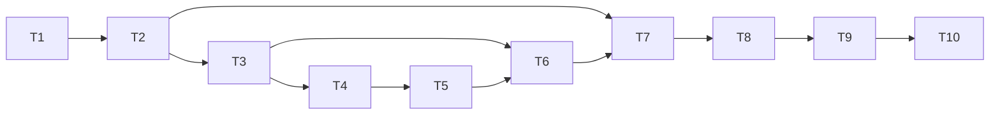

# Propuesta de Tareas — UC1: Conectar y Definir el Alcance del Repositorio

**Estado:** T1–T4 completadas — resto pendiente
**Stack:** Java 25+, Maven, JGit, picocli, JUnit 5 + AssertJ + Mockito
**Arquitectura:** Hexagonal + Pipeline (ver `docs/architecture.md`)

---

## Alcance (según `AGENTS.md`)

Seleccionar fuente (local/remota), especificar rango de análisis (`commit A..B` o últimos N commits) y validar que el repositorio exista y el rango sea coherente.

**Supuestos:** acceso Git que ya funcione en el entorno (local o HTTPS anónimo); sin gestión de SSH keys/tokens.

---

## Tareas

| # | Tarea | Paquete hexagonal | Descripción | Entregable |
| :--- | :--- | :--- | :--- | :--- |
| **T1** | ✅ Estructura Maven base | raíz | `pom.xml` con deps (JGit, picocli, JUnit, Mockito); paquetes `domain`, `application`, `ports`, `adapters.in/cli`, `adapters.out/jgit` | `mvn compile` OK — *ver nota de entorno abajo* |
| **T2** | ✅ Modelo de dominio | `domain/model`, `domain/exception` | `RepoScope` (fuente local/URL, rango `A..B` \| `LAST_N`), `AnalysisScope` (lista inmutable $C_1..C_n$), `ScopeException` | POJOs inmutables (records) — `Commit` añadido como modelo propio (evita exponer `RevCommit` de JGit al dominio); 15 tests ✅ |
| **T3** | ✅ Puerto de Git | `ports` | Interfaz `GitSourcePort`: `open(RepoScope)`, `resolveRange(RepoScope)`, `diff(prev, curr)` | Contrato compilable — con `RepositoryHandle` opaco (sin tipos JGit) y `CommitDelta` (contrato de salida de `diff`); `HexagonalArchitectureTest` verifica la regla 2 en bytecode; 16 tests ✅ |
| **T4** | ✅ Adaptador JGit: conexión | `adapters/out/jgit` | Abrir repo local (`Git.open`), clonar/verificar remoto (`cloneRepository`/`lsRemote`); detectar HEAD | `JGitAdapter` (conexión) — local `Git.open`, remoto clona a workspace temporal (`ddv-clone-*`) limpiado en `close()`; HEAD diferido a T5; 5 tests ✅ |
| **T5** | Adaptador JGit: rango | `adapters/out/jgit` | Resolver `A..B` y últimos N a `List<RevCommit>` (`RevWalk`, `log`); verificar ancestroía | `JGitAdapter` (rango) |
| **T6** | Caso de uso ScopeResolver | `application/uc1` | Orquesta T3–T5: valida fuente, rango coherente, no vacío → devuelve `AnalysisScope` | `ScopeResolver.java` |
| **T7** | Validaciones y errores | `domain/exception` | Repo inexistente/sin acceso, commits inexistentes, `A` no ancestro de `B`, rango vacío → `ScopeException` con mensajes claros | Excepciones tipadas |
| **T8** | CLI (adaptador de entrada) | `adapters/in/cli` | Comando picocli: `ddv analyze --repo <ruta\|URL> --range A..B \| --last N` → llama a `ScopeResolver` | `AnalyzeCommand.java` |
| **T9** | Salida hacia UC2 | `application` | Garantizar que `AnalysisScope` es el contrato que consumirá el bucle UC2→UC3→UC4 | Interfaz estable |
| **T10** | Pruebas y QA | `src/test` | Unitarias del dominio y `ScopeResolver` con `GitSourcePort` mockeado (Mockito); integración con repos JGit temporales (fixtures); E2E del comando CLI | Cobertura ≥ 80% en `application/uc1` y `adapters/out/jgit` |

---

## Orden y dependencias

**Secuencia sugerida:** T1 → T2 → T3 → T4 → T5 → T6 → T7 → T8 → T9 → T10
(T4/T5 pueden paralelizarse con T7 una vez exista T3; T7 puede avanzar en paralelo con T4/T5.)

---

## Notas de alineación arquitectónica

- **T2–T3 son puras** (sin framework): se testean sin JGit ni CLI.
- **T4–T5 son el adaptador de salida** de `GitSourcePort`: si mañana se cambia JGit por invocar al binario `git`, solo se reescribe `adapters/out/jgit`.
- **T6 es el caso de uso UC1**: no conoce JGit ni picocli; solo puertos.
- **T8 es el adaptador de entrada**: traduce argumentos CLI a `RepoScope` y formatea errores de `ScopeException`.

## Nota de entorno

- El entorno dispone de Temurin JDK 25.0.5.1+2 en `~/.local/jdks/jdk-25.0.5.1+2`. Configura `JAVA_HOME` y `PATH` como se indica en `README.md` para compilar y testear con el nivel Java requerido.

## Fuera de alcance de UC1

- Detección de diffs (UC2), análisis AST (UC3), diagramas (UC4/UC5)
- UI web (solo CLI)
- Gestión de credenciales complejas (SSH keys, tokens)
