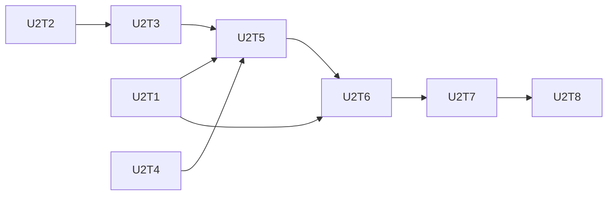

# Propuesta de Tareas — UC2: Ejecutar Detección de Diferencias (Δ)

**Estado:** U2T1–U2T2 completadas (2/8)
**Stack:** Java 25+, Maven, JGit, JUnit 5 + AssertJ + Mockito
**Arquitectura:** Hexagonal + Pipeline (ver `docs/architecture.md`)
**Predecesora:** UC1 completa (`docs/UC1-tasks.md`) · numeración `U2Tn` para no colisionar con las `Tn` de UC1

---

## Alcance (según `AGENTS.md`)

Iterar los commits $C_1..C_n$ del `AnalysisScope` resuelto por UC1 y, para cada par consecutivo $(C_{i-1}, C_i)$, generar un *diff* a nivel de código fuente registrando: **archivo**, **tipo de cambio** (Añadido/Modificado/Eliminado) y **la lista de archivos con cambios estructurales relevantes** (los que UC3 podrá parsear).

**Salida del caso de uso:** una secuencia ordenada de `CommitDelta` —uno por par— más su vista filtrada a ficheros fuente.

**Supuestos:**

- El rango llega validado como `AnalysisScope` (contrato congelado en UC1/T9).
- Diffs *tree-to-tree* simples: un commit se compara con su predecesor en el orden del rango; los merges no se modelan (ver «Fuera de alcance»).
- Relevancia a nivel de UC2 = *«es un fichero fuente del lenguaje analizable»*; la relevancia estructural real (¿contiene cambios de clases/métodos?) es de UC3 vía AST.
- Renombres: la detección está **activada** y cada rename se emite como dos `FileChange` (`origen → DELETED`, `destino → ADDED`) — decisión 3.

## Qué existe ya (heredado de UC1)

| Pieza | Origen | Estado |
| :--- | :--- | :--- |
| `CommitDelta` / `FileChange` / `ChangeType` (A/M/D) | UC1 T3 + T7 | ✅ con tests — es exactamente la forma que registra este caso de uso |
| `GitSourcePort.diff(handle, previous, current)` | UC1 T3 | ✅ firma congelada; implementación pendiente |
| `JGitAdapter.diff()` | UC1 T4 | ⏳ lanza `UnsupportedOperationException` |
| `AnalysisScope.consecutivePairs()` | UC1 T2/T9 | ✅ lista de pares $(C_{i-1}, C_i)$ en orden ascendente |
| `DiffExtractor` (etapa del pipeline) | `application/pipeline` | ⏳ solo `package-info` |

---

## Tareas

| # | Tarea | Paquete hexagonal | Descripción | Entregable |
| :--- | :--- | :--- | :--- | :--- |
| **U2T1** | ✅ Contrato de salida Δ | `domain/model` | Secuencia de `CommitDelta` alineada 1:1 con `consecutivePairs()`, inmutable y trazable al `AnalysisScope` de origen | `DeltaSequence` (record; invariante de nº de Δ y de orden validados en el constructor → `DiffException`) + `DeltaSequenceTest` (6 tests) ✅ |
| **U2T2** | ✅ Excepción tipada de Δ | `domain/exception` | Errores de extracción sin mezclarlos con el `ScopeException` del alcance | `DiffException` (`INVALID_ARGUMENT`/`IO_ERROR`/`UNSUPPORTED`); `FileChange` migra; matriz en `docs/class-diagram.md` ✅ |
| **U2T3** | Adaptador JGit: diff | `adapters/out/jgit` | `GitSourcePort.diff()` real: comparar árboles de `previous` y `current` → `FileChange` A/M/D, con detección de renames activada emitiendo `origen→DELETED` + `destino→ADDED`; traducir errores de JGit | `JGitAdapter.diff()` + tests (añadir, modificar, borrar, rename, binario, commit vacío, handle cerrado) |
| **U2T4** | Filtro de ficheros fuente | `application/pipeline` | De todos los archivos del Δ, qué ficheros puede parsear UC3 (extensión del lenguaje MVP) | `SourceFileFilter` inyectable + tests |
| **U2T5** | Caso de uso DiffExtractor | `application/pipeline` | Bucle UC2: `open → diff(Cᵢ₋₁, Cᵢ) por cada par → close` → `DeltaSequence` + vista filtrada para UC3 | `DiffExtractor` + tests con `GitSourcePort` mockeado (espejo de `ScopeResolverTest`) |
| **U2T6** | Contrato hacia UC3 | `application/pipeline` | Garantizar que UC3 consumirá (par, Δ) alineados sin código adhesivo | contract test estilo T9 (`GitSourcePortContractTest`) + garantías en javadoc |
| **U2T7** | E2E UC1 → UC2 | `src/test` | Encadenar `ScopeResolver` + `DiffExtractor` con JGit real sobre repos temporales | `DiffExtractorE2ETest` con varios commits A/M/D (usa `GitFixtures`) |
| **U2T8** | QA y documentación | `docs`, `src/test` | Métricas de cobertura y diagramas al día (reglas 1 y 6) | tabla de métricas abajo + `class-diagram.md` + `architecture.md` §5 con la etapa real |

---

## Orden y dependencias

**Secuencia sugerida:** U2T1 → U2T2 → U2T3 → U2T4 → U2T5 → U2T6 → U2T7 → U2T8
(U2T1 y U2T2 son independientes y pueden paralelizarse; U2T4 puede avanzar con U2T3.)

---

## Decisiones tomadas (2026-11-23)

1. **Contrato de salida:** `DeltaSequence` (record con invariante `deltas.size() == consecutivePairs().size()`), espejo del `AnalysisScope` de UC1.
2. **Excepción:** `DiffException` nueva (la prevee el árbol de `docs/architecture.md`); `FileChange` migra de `ScopeException` a ella.
3. **Renombres:** detección **activada** en JGit y cada rename se traduce a dos `FileChange` (`origen → DELETED`, `destino → ADDED`) — distingue un rename de un borrado+alta independiente.
4. **Lenguaje del filtro (U2T4):** **Java** (`.java`), coherente con `AstParserAdapter`.

---

## Notas de alineación arquitectónica

- **U2T3 es el adaptador de salida** de `GitSourcePort.diff()`: la firma no cambia (regla hexagonal); si JGit se sustituye, solo se reescribe `adapters/out/jgit`.
- **U2T5 es la etapa `DiffExtractor`** del pipeline de `docs/architecture.md` §5: depende solo de `domain` y `ports`, testeable con mocks sin Git.
- **El gate JaCoCo (≥80% de líneas por paquete)** ya está en `pom.xml` y cubre automáticamente los paquetes nuevos: U2T8 solo publica las métricas.
- **Regla 6:** toda tarea que añada, elimine o modifique tipos o relaciones actualiza `docs/class-diagram.md` en la misma modificación.

## Fuera de alcance de UC2

- Relevancia estructural real y parseo AST (UC3) · diagramas (UC4) · comparación global (UC5)
- Diffs de merge, detección semántica de renames, submódulos, Git LFS, binarios con contenido
- Nuevos flags de CLI: la salida de UC2 es interna del pipeline (la CLI no lo expone aún)
- Gestión de credenciales para remotos

## Métricas de cobertura (JaCoCo)

*(se rellena en U2T8 — gate activo: `PACKAGE ≥ 0.80` líneas en `mvn clean test`)*
