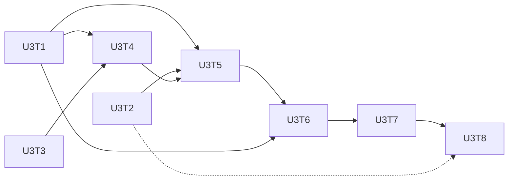

# Propuesta de Tareas — UC3: Analizar Estructura Cambiada por Commit

**Estado:** U3T1–U3T6 completadas (6/8)
**Stack:** Java 25+, Maven, JGit, **JavaParser**, JUnit 5 + AssertJ + Mockito
**Arquitectura:** Hexagonal + Pipeline (ver `docs/architecture.md`)
**Predecesoras:** UC1 (`docs/UC1-tasks.md`) y UC2 (`docs/UC2-tasks.md`) completas · numeración `U3Tn`

---

## Alcance (según `AGENTS.md`)

Parsear el código afectado en cada commit para identificar las estructuras
semánticas nuevas, **sin ejecutar el código**. Para cada archivo del Δ:

1. **Identificar clases/estructuras** — nuevas definiciones de `class` (y
   equivalentes: `interface`, `enum`, `record`).
2. **Detectar miembros** — métodos y atributos **añadidos o eliminados** en
   comparación con $C_{i-1}$.
3. **Mapear dependencias** — `import` o referencias de tipo que dan nuevas
   dependencias estructurales («la Clase A ahora usa la Clase B»).

El resultado se guarda como representación estructurada en memoria: **$S_i$**
(`StructuralChange`), que es lo que consume UC4 para el diagrama.

**Salida del caso de uso:** un $S_i$ por par consecutivo del `DeltaSequence`
de UC2, alineado con él.

**Supuestos:**

- Lenguaje MVP: **Java** (decisión 4 de UC2) con parser **JavaParser** (decisión 1).
- Para restar estructuras hace falta leer el archivo **en los dos commits**
  (versión vieja y nueva): es la decisión 3 (acceso al contenido).
- **Dependencias = referencias de tipo completas** (decisión 4): `import` +
  `extends`/`implements` + tipos usados en firmas, atributos y cuerpos.
- El analizador **no tiene classpath**, así que las referencias se recogen **por
  nombre** y se desambiguan con los `import` del propio archivo cuando existen
  (no hay resolución de símbolos en el MVP).
- Un **rename** llega como `DELETED` + `ADDED` (decisión 3 de UC2) → se ve como
  «clase fuera de la ruta antigua, clase nueva en la nueva»; no hay seguimiento
  semántico de renames.
- Los archivos no fuente (`.md`, binarios…) ya quedaron fuera en UC2
  (`relevantChanges()` / `SourceFileFilter`).

## Qué existe ya (heredado de UC2)

| Pieza | Origen | Estado |
| :--- | :--- | :--- |
| `DeltaSequence` — una Δ por par, alineada | UC2 U2T1/U2T6 | ✅ contrato bloqueado por `DeltaSequenceContractTest` |
| `SourceFileFilter` (`.java`) + `relevantChanges()` | UC2 U2T4/U2T5 | ✅ 100% cobertura |
| `GitSourcePort.diff()` / `JGitAdapter.diff()` | UC2 U2T3 | ✅ A/M/D con renames |
| `ParserPort`, `AstParserAdapter` | UC3 U3T4 | ✅ `parse(path, source) → CodeStructure` con JavaParser (`javaparser-core` 3.28.2) |
| `StructuralAnalyzer` | `application/pipeline/package-info` | ✅ implementada en U3T5 |
| `StructuralChange` | `docs/architecture.md` (árbol) | ✅ creado en U3T1 (con Δ de origen desde U3T5) + `StructuralSequence` |
| `GitSourcePort` (contenido de un blob) | UC3 U3T2 | ✅ `content(handle, commit, path) → Optional<String>`, implementado en `JGitAdapter` |

---

## Tareas

| # | Tarea | Paquete hexagonal | Descripción | Entregable |
| :--- | :--- | :--- | :--- | :--- |
| **U3T1** | ✅ Modelos de estructura | `domain/model` | Tipos inmutables para lo que parsea y para $S_i$: clases, miembros, **dependencias (referencias de tipo completas)** y sus altas/bajas | `CodeStructure` (con `ClassStructure`, `MemberStructure`, `ClassKind`, `MemberKind`) + `StructuralChange` (con `FileStructureChange`, `ClassChange`, `ChangeKind`) + `CodeStructureTest` y `StructuralChangeTest` (12 tests) ✅ |
| **U3T2** | ✅ Acceso a contenido | `ports`, `adapters/out/jgit` | Leer el blob de un archivo **en un commit concreto** (versión vieja y nueva de cada Δ) | `GitSourcePort.content(...) → Optional<String>` + `JGitAdapter` (`TreeWalk.forPath`, UTF-8, `OBJ_BLOB` para descartar directorios) + 6 tests: punto en el tiempo, ausente, UTF-8, directorio, handle ajeno, commit inexistente ✅ |
| **U3T3** | ✅ Excepción de parseo | `domain/exception` | Errores de sintaxis sin mezclarlos con `ScopeException` ni `DiffException` | `ParseException` (`SYNTAX_ERROR`/`INVALID_INPUT`) + validador estático `requireNotBlank` + `DdvAssertions.assertParseThrows` + matriz en `docs/class-diagram.md` ✅ |
| **U3T4** | ✅ Puerto y adaptador AST | `ports`, `adapters/out/ast` | `ParserPort.parse(código) → CodeStructure` con **JavaParser**, recolectando clases, miembros y **referencias de tipo** (imports, herencia y usos en firmas/cuerpos) | `ParserPort`, `AstParserAdapter` (nivel `JAVA_25`, sin resolución de símbolos) + 9 tests: 4 tipos de clase, anidamiento cualificado, superTypes vs usages, imports wildcard/estáticos, miembros no se filtran entre clases, sintaxis, ruta en blanco, fuente vacía ✅ |
| **U3T5** | ✅ Caso de uso StructuralAnalyzer | `application/pipeline` | Por cada Δ: abre el repo, lee contenidos viejo/nuevo de los `.java`, parsea ambos y **resta** estructuras → $S_i$ por par | `StructuralAnalyzer.analyze()` (try-with-resources, filtro antes de leer) + `FileStructureChange.between()` (resta pura en dominio) + `StructuralChange.delta` (procedencia) + `StructuralSequence` (alineación 1:1) + 23 tests ✅ |
| **U3T6** | ✅ Contrato hacia UC4 | `application/pipeline` | Garantizar que UC4 recibirá $S_i$ completo (clases, métodos añadidos, dependencias nuevas) sin código adhesivo | `StructuralSequenceContractTest` (3 tests con generador de diagramas falso sobre la salida real del analizador: un diagrama por Δ en orden, commits etiquetados, clases/miembros/dependencias añadidos, rango de 1 commit → 0) + garantías en javadoc ✅ |
| **U3T7** | E2E UC1 → UC2 → UC3 | `src/test` | Cadena real (JGit + parser) sobre un repo temporal cuyas clases evolucionan | `StructuralAnalyzerE2ETest` sin mocks |
| **U3T8** | QA y documentación | `docs`, `src/test` | Métricas de cobertura y diagramas al día (reglas 1 y 6) | tabla de métricas abajo + `class-diagram.md` + `architecture.md` §4/§5 |

---

## Orden y dependencias

**Secuencia sugerida:** U3T1 → U3T2 → U3T3 → U3T4 → U3T5 → U3T6 → U3T7 → U3T8
(U3T1, U3T2 y U3T3 son independientes entre sí y pueden paralelizarse.)

---

## Decisiones tomadas (2026-11-23)

1. **Parser AST:** **JavaParser** (`com.github.javaparser:javaparser-core`) —
   ligero, activo, API limpia; suficiente para extraer la estructura del MVP.
2. **Forma del puerto — dos pasos:** `ParserPort.parse(código) → CodeStructure`
   y `StructuralAnalyzer` **resta** las dos estructuras. El parser queda tonto y
   testeable con un doble falso; el diff de estructuras vive en el caso de uso.
   (Sustituye a la forma monolítica `parse(archivo, diff) → StructuralChange`
   que sugería `architecture.md` §4 — se actualiza ese documento.)
3. **Acceso al contenido — ampliar `GitSourcePort`:**
   `content(handle, commit, path) → Optional<String>`, implementado en
   `JGitAdapter`: mismo adaptador y mismo ciclo de vida del handle que
   `resolveRange()`/`diff()`.
4. **Alcance de dependencias — referencias de tipo completas:** `import` +
   `extends`/`implements` + tipos usados en firmas, atributos y cuerpos (sin
   resolución de símbolos: por nombre, desambiguado con los `import` locales).
5. **Errores de parseo:** **`ParseException`** nueva (`SYNTAX_ERROR` /
   `INVALID_INPUT`) — cada excepción nombra su preocupación: `ScopeException`
   (alcance), `DiffException` (Δ), `ParseException` (sintaxis).

---

## Notas de alineación arquitectónica

- **U3T2/U3T4 son adaptadores de salida** (`adapters/out/jgit`, `adapters/out/ast`)
  detrás de puertos: cambiar JavaParser por JDT o JGit por el binario `git` no
  toca `application/` ni `domain/`.
- **U3T5 es la etapa `StructuralAnalyzer`** del pipeline: depende solo de
  `domain` y `ports`, testeable con mocks sin Git ni parser real.
- **Agrupación por par:** `StructuralAnalyzer` recorre `sequence.deltas()` y
  aplica su propio `SourceFileFilter` inyectado a cada Δ — así conserva la
  agrupación por commit sin ampliar el contrato de UC2.
- **El gate JaCoCo (≥80% de líneas por paquete)** cubre automáticamente los
  paquetes nuevos: U3T8 solo publica las métricas.
- **Regla 6:** toda tarea que añada, elimine o modifique tipos o relaciones
  actualiza `docs/class-diagram.md` en la misma modificación.

## Fuera de alcance de UC3

- Generación de diagramas (UC4) · persistencia/comparación global (UC5)
- Refactors, renames semánticos, análisis de dependencias más allá de
  imports/`extends`/`implements`, análisis entre archivos no relacionados
- Multi-lenguaje (solo Java en el MVP), parseo incremental, caché de ASTs
- Diagnóstico avanzado de errores de sintaxis (posición/línea en mensajes)

## Métricas de cobertura (JaCoCo)

*(se rellena en U3T8 — gate activo: `PACKAGE ≥ 0.80` líneas en `mvn clean test`)*
