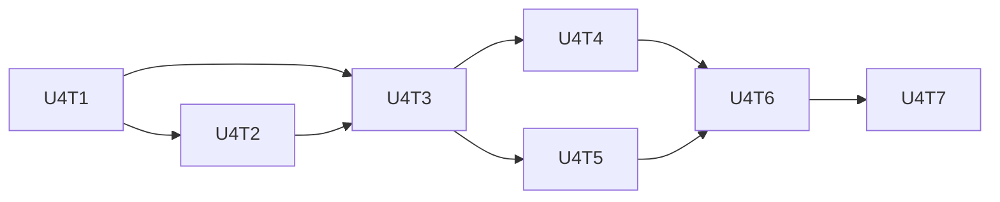

# Propuesta de Tareas — UC4: Generar Diagrama UML por Commit

**Estado:** U4T1–U4T2 completadas (2/7)
**Stack:** Java 25+, Maven, JGit, JavaParser, JUnit 5 + AssertJ + Mockito
**Arquitectura:** Hexagonal + Pipeline (ver `docs/architecture.md`)
**Predecesoras:** UC1, UC2 y UC3 completas · numeración `U4Tn`

---

## Alcance (según `AGENTS.md`)

Crear un diagrama visual que represente las estructuras **añadidas o
modificadas significativamente** del commit $C_i$:

1. **Tomar los elementos clave de $S_i$** — clases, métodos añadidos,
   dependencias nuevas.
2. **Construir la notación UML** que refleje *solo* estos cambios.
3. **Exportar** el diagrama en un formato visualizable y reproducible.

**Salida del caso de uso:** un diagrama por commit con cambios estructurales,
alineado con el `StructuralSequence` de UC3.

**Supuestos:**

- Formato de salida según decisión 1 (por defecto **Mermaid**, en línea con la
  regla 1 del proyecto y con `MermaidRenderer` ya anunciado en
  `docs/architecture.md` §4).
- PNG/SVG quedan **fuera del alcance**: el MVP exporta texto reproducible que
  el navegador/GitHub renderiza (regla 1).
- El contenido visual sigue la decisión 5 (por defecto: solo cambios
  significativos, no la clase completa).
- Los commits **sin** cambios estructurales **sí** generan diagrama, con un
  placeholder «sin cambios» (decisión 4) — UC5 necesita un punto por commit.

## Qué existe ya (heredado de UC3)

| Pieza | Origen | Estado |
| :--- | :--- | :--- |
| `StructuralSequence` — un $S_i$ por Δ, alineado | UC3 U3T5 | ✅ contrato validado (`StructuralSequenceTest`) |
| `StructuralChange.delta` (commits del par) + `ClassChange` (alta/baja, miembros y dependencias) | UC3 U3T1/U3T5 | ✅ con trazabilidad |
| **Lo que UC4 necesita leer** | UC3 U3T6 | ✅ fijado por `StructuralSequenceContractTest`: un diagrama por Δ en orden, con commits, clases, miembros y dependencias añadidos |
| `RendererPort` → `MermaidRenderer` | `adapters/out/mermaid/package-info` | ✅ implementado en U4T2 (`render(DiagramSpec) → String`) |
| `DiagramSpec` | `docs/architecture.md` (árbol de dominio) | ✅ creado en U4T1 (con `DiagramException`) |
| `DiagramGenerator` | `application/pipeline/package-info` y `architecture.md` §5 | ⏳ nombrado en el pipeline, sin implementar |
| `StorePort` → `FileStoreAdapter` | `adapters/out/file/package-info` | ⏳ la decisión 3 lo trae adelante a UC4 (U4T4); UC5 lo amplía con S₁..Sₙ |

---

## Tareas

| # | Tarea | Paquete hexagonal | Descripción | Entregable |
| :--- | :--- | :--- | :--- | :--- |
| **U4T1** | ✅ Modelo de diagrama | `domain/model` | Representación neutra y sin dependencias de formato: nodos de clase con su estado (añadida/modificada/eliminada) y miembros añadidos, aristas de dependencia nueva, etiqueta del commit | `DiagramSpec` (con `Node`, `Edge`; reutiliza `StructuralChange.ChangeKind`) + `DiagramException` (`INVALID_INPUT`/`WRITE_ERROR`) + `DiagramSpecTest` (7 tests) ✅ |
| **U4T2** | ✅ Puerto y adaptador de render | `ports`, `adapters/out/mermaid` | `RendererPort.render(DiagramSpec) → String` con `MermaidRenderer` emitiendo sintaxis `classDiagram` válida | puerto + adaptador (Markdown completo o placeholder; anotaciones, `..>`, sanitizado de nombres/tipos) + 5 tests — `adapters/out/mermaid` al 100% ✅ |
| **U4T3** | Caso de uso DiagramGenerator | `application/pipeline` | `StructuralSequence` → un `DiagramSpec` por Δ con las estructuras **añadidas o modificadas significativamente**; los commits sin cambios producen un spec vacío que el render convierte en placeholder | `DiagramGenerator` + tests con secuencias construidas |
| **U4T4** | Exportación a disco | `ports`, `adapters/out/file` | Escribir cada diagrama como `.md` con su bloque Mermaid, reproducible y versionable (decisión 3) | puerto + `FileStoreAdapter` + tests con `@TempDir` |
| **U4T5** | Contrato hacia UC5 | `application/pipeline` | UC5 podrá recorrer los diagramas alineados con sus $S_i$ y deltas sin código adhesivo | contract test estilo T9 + garantías en javadoc |
| **U4T6** | E2E UC1 → UC4 | `src/test` | Cadena real (JGit + JavaParser + render) hasta el texto Mermaid en disco | E2E sin mocks sobre un repo con evolución de clases |
| **U4T7** | QA y documentación | `docs`, `src/test` | Métricas de cobertura y diagramas al día (reglas 1 y 6) | tabla de métricas abajo + `class-diagram.md` + `architecture.md` §4/§5 |

---

## Orden y dependencias

**Secuencia sugerida:** U4T1 → U4T2 → U4T3 → U4T4 → U4T5 → U4T6 → U4T7
(U4T2 y U4T3 pueden avanzar en paralelo tras U4T1; U4T5 espera a U4T3.)

---

## Decisiones tomadas (2026-11-24)

1. **Formato de salida:** **Mermaid** (`classDiagram` dentro de un `.md`) —
   coherente con la regla 1 del proyecto y con el `MermaidRenderer` ya
   anunciado en `docs/architecture.md` §4. PNG/SVG y PlantUML quedan fuera.
2. **Descomposición en dos pasos:** `DiagramGenerator` construye un
   `DiagramSpec` **neutro de lenguaje** y `RendererPort.render(DiagramSpec) →
   String` emite el texto — un futuro `PlantUMLAdapter` reutiliza el modelo
   («cero cambios en `application/`»). Sustituye a la forma ambigua
   `render(Sᵢ) → DiagramSpec` que hoy recoge `architecture.md` §4: **actualizar
   ese documento en U4T2**.
3. **Exportación en UC4:** `StorePort.saveDiagram(...)` + `FileStoreAdapter`
   escriben el `.md` — el caso de uso «exportar» queda cerrado de punta a
   punta; UC5 **amplía** el mismo puerto con la persistencia de $S_1..S_n$
   (el `package-info` de `adapters/out/file` pasa de «UC5» a «UC4–UC5» en
   U4T4).
4. **Commits sin cambios:** **placeholder «sin cambios estructurales»** — un
   diagrama por commit del rango, para que UC5 tenga un punto por commit en la
   trayectoria (el spec sale vacío y el render emite el placeholder).
5. **Contenido visual:** **solo cambios significativos** — clases
   añadidas/modificadas/eliminadas como nodos, miembros añadidos en la etiqueta
   y dependencias nuevas como aristas; no se dibuja la clase completa.

---

## Notas de alineación arquitectónica

- **U4T2 es el adaptador de salida** de `RendererPort`: cambiar Mermaid por
  PlantUML o por SVG es una clase nueva en `adapters/out/`, sin tocar
  `application/` ni `domain/` (beneficio ya listado en `architecture.md` §6).
- **U4T3 es la etapa `DiagramGenerator`** del pipeline: depende solo de
  `domain` y `ports`, testeable sin Git, sin parser y sin disco.
- **Regla 1:** los diagramas *del proyecto* siguen siendo Mermaid en `docs/`;
  la decisión 1 alinea también la salida de la herramienta con esa convención.
- **El gate JaCoCo (≥80% de líneas por paquete)** cubre los paquetes nuevos:
  U4T7 solo publica las métricas.
- **Regla 6:** toda tarea que añada, elimine o modifique tipos o relaciones
  actualiza `docs/class-diagram.md` en la misma modificación.

## Fuera de alcance de UC4

- Render a PNG/SVG (requiere mermaid-cli/node) · PlantUML (futuro adaptador)
- Persistencia de $S_1..S_n$ y comparación global (UC5)
- Diagramas de paquetes/secuencias/temporales: solo **clases** (UML de clases)
- Estilos visuales avanzados (colores por paquete, leyendas), animación o
  interactividad

## Métricas de cobertura (JaCoCo)

*(se rellena en U4T7 — gate activo: `PACKAGE ≥ 0.80` líneas en `mvn clean test`)*
