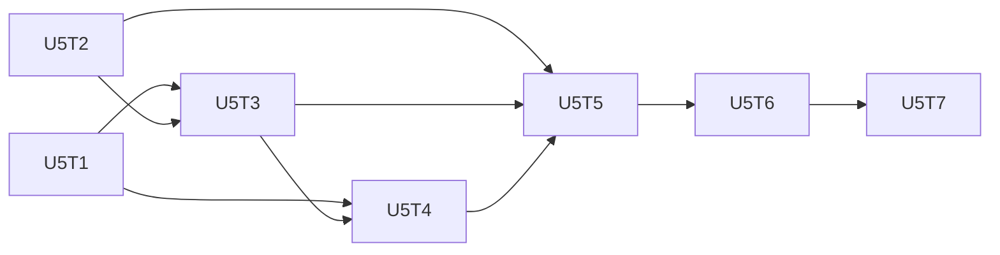

# Propuesta de Tareas — UC5: Comparar Evolución Estructural Global

**Estado:** por iniciar (0/7) — decisiones tomadas (ver abajo)
**Stack:** Java 25+, Maven, JGit, JavaParser, JUnit 5 + AssertJ + Mockito
**Arquitectura:** Hexagonal + Pipeline (ver `docs/architecture.md`)
**Predecesoras:** UC1, UC2, UC3 y UC4 completas · numeración `U5Tn`

---

## Alcance (según `AGENTS.md`)

Permitir al analista ver la **trayectoria de una entidad específica** («¿Cómo ha
evolucionado la clase `PaymentProcessor`?») a lo largo de todo el historial
seleccionado:

1. El analista **selecciona una clase** objetivo.
2. El sistema **recopila todas las modificaciones** detectadas en ese elemento a
   lo largo de $C_1 \dots C_n$.
3. Genera un **resumen textual y/o un diagrama de «trayectoria»** que muestra el
   estado del componente y sus dependencias clave en cada punto temporal
   relevante.

Dependencia acumulativa: el resultado es una **síntesis del proceso completo**
— requiere los $S_1..S_n$ almacenados por UC2–UC4 (`«include»` sobre UC4).

**Supuestos:**

- UC1–UC4 completas: los `.md` se exportan y los $S_i$ viven en un
  `DiagramSequence` **en memoria** — pero nada los persiste todavía; lo hará el
  `DiagramExporter` (decisión 2).
- **La CLI hoy solo ejecuta UC1** (`DdvCommand` cablea `ScopeResolver`): UC2–UC4
  son biblioteca con tests E2E. U5T5 la convierte en el pipeline completo
  (decisión 4).
- El identificador de la clase es **tal cual aparece en $S_i$** (nombres
  calificados dentro del archivo, sin paquete): la coincidencia entre commits
  es por igualdad exacta — límite heredado de UC3, documentado.
- Mermaid sigue siendo el formato de salida (decisión 1 de UC4).

## Qué existe ya (heredado de UC4)

| Pieza | Origen | Estado |
| :--- | :--- | :--- |
| `DiagramSequence` con procedencia completa (`source` → `StructuralSequence` → `DeltaSequence` → `AnalysisScope`) | UC4 U4T3 | ✅ contrato validado |
| **Lo que UC5 consume** | UC4 U4T5 | ✅ fijado por `DiagramSequenceContractTest`: línea temporal por commit, **trayectoria de clase** (estado + miembros por commit), punto *placeholder* para commits sin cambios y procedencia hasta el rango original |
| `StructuralChange` / `ClassChange` (estados, miembros y dependencias añadidos) | UC3 U3T1/U3T5 | ✅ con trazabilidad al Δ |
| `StorePort.saveDiagram` + `FileStoreAdapter` (escritura) | UC4 U4T4 | ✅ — **faltan cargas y estados** (decisión 1/2) |
| `application/evolution` (paquete) | rename de UC5 | ✅ solo `package-info` |
| `MermaidRenderer` | UC4 U4T2 | ✅ reutilizable para la trayectoria |
| `EvolutionComparer` anunciado en `architecture.md` §5/§7 y `class-diagram.md` | docs | ⏳ sin implementar |

---

## Tareas

| # | Tarea | Paquete hexagonal | Descripción | Entregable |
| :--- | :--- | :--- | :--- | :--- |
| **U5T1** | Modelo de trayectoria | `domain/model` | Inmutable y validado: nombre de clase objetivo + puntos temporales (commit, estado, miembros y dependencias añadidos, indicador de *sin cambios*) | `ClassTrajectory` (y anidados) + tests de contrato |
| **U5T2** | Persistencia de estados y cargas | `ports`, `adapters/out/file` | Ampliar `StorePort` con `saveStates`/`loadStates` (+ carga de diagramas si la decisión 4/1 lo pide) y su formato | **JSON con Gson** (decisión 1) escrito por el `DiagramExporter` (decisión 2); puerto + adaptador + tests *round-trip* con `@TempDir` |
| **U5T3** | Comparador de evolución | `application/evolution` | De los estados cargados, **seleccionar la clase** y recopilar sus modificaciones a lo largo del rango (incluyendo los puntos *sin cambios*) | `EvolutionComparer` + tests con secuencias construidas |
| **U5T4** | Salida de UC5 | `application/evolution`, `adapters/out/mermaid` | Resumen textual **y** diagrama de trayectoria en Mermaid (decisión 3), reutilizando `MermaidRenderer`/`RendererPort` | salida + tests |
| **U5T5** | Cableado de CLI | `adapters/in/cli` | `ddv analyze` pasa a ejecutar el pipeline completo (UC1→UC4) y acepta `--track <clase>` opcional que añade UC5 (decisión 4) | flag + comportamiento + tests |
| **U5T6** | E2E UC1 → UC5 | `src/test` | Cadena completa real: pipeline → persistir → **recargar desde disco** → trayectoria → salida | E2E sin mocks con `@TempDir` |
| **U5T7** | QA y documentación | `docs`, `src/test` | Métricas de cobertura y diagramas al día (reglas 1 y 6) | tabla de métricas abajo + `class-diagram.md` + `architecture.md` |

---

## Orden y dependencias

**Secuencia sugerida:** U5T1 → U5T2 → U5T3 → U5T4 → U5T5 → U5T6 → U5T7
(U5T1 y U5T2 son independientes y pueden paralelizarse.)

---

## Decisiones tomadas (2026-11-24)

1. **Formato de persistencia de $S_1..S_n$:** **JSON con Gson**
   (`com.google.code.gson:gson`) — robusto, estándar y sin transitivas; el
   modelo ya es un árbol de registros. Añade la dependencia al `pom.xml` en
   U5T2.
2. **Quién persiste los estados:** el **`DiagramExporter`** — ya recibe el
   `DiagramSequence` y escribe los `.md`, así que un solo paso de exportación
   deja todo en disco para UC5 (`saveDiagram` + `saveStates`).
3. **Salida de UC5:** **resumen textual + diagrama de trayectoria** (el «y/o»
   de `AGENTS.md` cubierto al completo), el diagrama en Mermaid.
4. **Superficie de CLI:** **`ddv analyze` pasa a ejecutar el pipeline completo
   (UC1→UC4)** —exportando los `.md`— **y acepta `--track <clase>` opcional**
   que añade UC5: un solo comando y progresivo.

---

## Notas de alineación arquitectónica

- **U5T2/U5T4 son adaptadores** detrás de puertos: cambiar filesystem/JSON por
  otra persistencia o el formato de salida no toca `application/` ni `domain/`.
- **U5T3 es el caso de uso UC5** (`application/evolution`): depende solo de
  `domain` y `ports`, testeable sin Git, sin disco y sin parser.
- **El gate JaCoCo (≥80% de líneas por paquete)** cubre los paquetes nuevos:
  U5T7 solo publica las métricas.
- **Regla 6:** toda tarea que añada, elimine o modifique tipos o relaciones
  actualiza `docs/class-diagram.md` en la misma modificación.
- **`refactors.md` R3** (constantes `Instant` duplicadas en 7 clases) vuelve a
  crecer con el E2E de U5T6: al tocar esos tests.

## Fuera de alcance de UC5

- Seguimiento de **varias clases** a la vez (el MVP rastrea una por ejecución)
- Comparación entre ramas o rangos distintos; historias con renames de clases
- Búsqueda difusa («como *PaymentProcessor*»): coincidencia exacta de nombre
- Export a PNG/SVG/PDF, UI, notificaciones o informes agregados
- Persistencia entre ejecuciones distintas de la herramienta más allá de lo que
  el propio pipeline escriba (no hay «proyecto» guardado)

## Métricas de cobertura (JaCoCo)

*(se rellena en U5T7 — gate activo: `PACKAGE ≥ 0.80` líneas en `mvn clean test`)*
