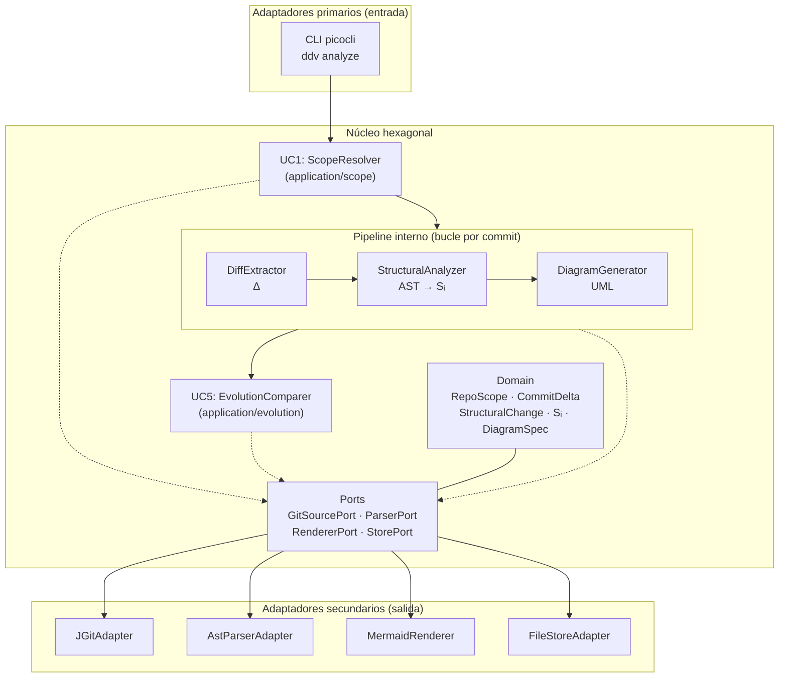
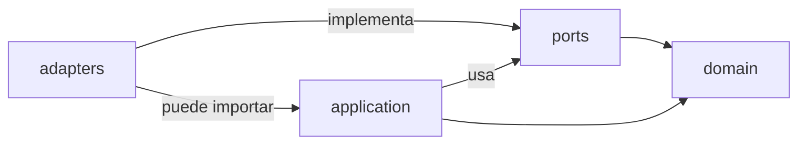
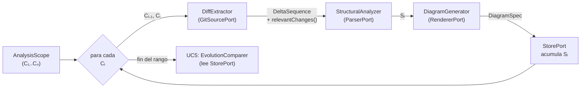

# Arquitectura — DDV (Detección de Diferencias Versionadas)

**Estilo elegido:** Hexagonal (Ports & Adapters) + Pipeline interno para el bucle UC2→UC3→UC4.
**Stack:** Java 25+, Maven, JGit, picocli, JUnit 5 + AssertJ + Mockito.

---

## 1. Principio rector

> **Las dependencias apuntan hacia adentro.** El núcleo (`domain`, `application`, `ports`) nunca importa frameworks ni adaptadores (JGit, picocli, JPA…). Los adaptadores (`adapters/`) implementan los puertos (`ports/`); nunca al revés.

- El **pipeline** (diff → análisis AST → diagrama) es el *algoritmo* de DDV.
- La **hexagonal** es la *estructura*: quién depende de qué y dónde se toca el mundo exterior.

---

## 2. Diagrama de componentes



---

## 3. Estructura de paquetes

```
ddv/
├── domain/                  # Puro: cero dependencias externas
│   ├── model/               #   RepoScope, CommitDelta, CodeStructure, StructuralChange, DiagramSpec
│   └── exception/           #   ScopeException, DiffException...
├── application/             # Casos de uso + pipeline (solo depende de domain y ports)
│   ├── scope/               #   ScopeResolver (UC1)
│   ├── pipeline/            #   DiffExtractor → StructuralAnalyzer → DiagramGenerator
│   └── evolution/           #   EvolutionComparer (UC5)
├── ports/                   # Interfaces (contrato hexagonal)
│   ├── GitSourcePort.java
│   ├── ParserPort.java
│   ├── RendererPort.java
│   └── StorePort.java
└── adapters/
    ├── in/cli/              # picocli → llama a application
    └── out/
        ├── jgit/            # GitSourcePort vía JGit
        ├── ast/             # ParserPort vía parser AST
        ├── mermaid/         # RendererPort → bloques Mermaid
        └── file/            # StorePort → Sᵢ y diagramas en disco
```

**Regla de dependencia (importaciones):**



Prohibido: `domain` importando de `application`, `ports` o `adapters`; `application` importando de `adapters`.

---

## 4. Puertos y adaptadores

| Puerto (`ports/`) | Adaptador (`adapters/out/`) | Responsabilidad |
| :--- | :--- | :--- |
| `GitSourcePort` | `JGitAdapter` | Abrir/clone del repo, resolver rango $C_1..C_n$, extraer diff entre $C_{i-1}, C_i$ |
| `ParserPort` | `AstParserAdapter` (JavaParser) | `parse(código) → CodeStructure` (clases, miembros, referencias de tipo); la resta viejo vs nuevo la hace `StructuralAnalyzer` → `StructuralChange` |
| `RendererPort` | `MermaidRenderer` | `render(Sᵢ) → DiagramSpec` (futuro: `PlantUMLAdapter`) |
| `StorePort` | `FileStoreAdapter` | Persistir/cargar $S_1..S_n$ y diagramas (requisito acumulativo de UC5) |

```java
public interface GitSourcePort {
    RepositoryHandle open(RepoScope scope);                        // AutoCloseable opaco
    AnalysisScope resolveRange(RepositoryHandle repo, RepoScope scope); // C₁..Cₙ
    CommitDelta diff(RepositoryHandle repo, Commit previous, Commit current); // Δ por commit
    Optional<String> content(RepositoryHandle repo, Commit commit, String path); // blob en ese commit
}
```

> `RepositoryHandle` es opaco a propósito: el núcleo nunca ve tipos de JGit.

---

## 5. El pipeline interno (UC2 → UC3 → UC4)



- **Implementado (UC2):** `SourceFileFilter` y `DiffExtractor` (U2T4–U2T5) con `JGitAdapter.diff()` (U2T3). La salida hacia UC3 es `DeltaSequence` —una Δ por par, alineada con `consecutivePairs()`— más `relevantChanges()` (solo ficheros `.java`); ambos contratos están bloqueados por `DeltaSequenceContractTest`.
- Cada etapa es una clase con **un solo método** y depende solo de puertos → testeable con mocks (Mockito) sin Git ni disco.
- El `StorePort` materializa la "acumulación de datos" que UC5 requiere (su `«include»` sobre UC4).
- **Contrato de entrada del bucle (T9):** `AnalysisScope` es estable — orden ascendente, inmutabilidad y `consecutivePairs()` en el mismo orden; bloqueado por `AnalysisScopeTest` y `GitSourcePortContractTest` (cabecera del bucle contra un puerto falso).

---

## 6. Beneficios y costes

| Beneficio | Coste / riesgo |
| :--- | :--- |
| Tests unitarios del núcleo sin JGit ni repos reales | Boilerplate inicial: interfaces + POJOs antes de la primera funcionalidad |
| Añadir `PlantUMLAdapter` u otro lenguaje = clase nueva, cero cambios en `application/` | Riesgo de "hexagonal a medias" si un framework se cuela en `domain/` → regla en `AGENTS.md` § Reglas |
| El bucle por commit queda encapsulado e invisible para la CLI | |
| `ParserPort`/`RendererPort` son el germen de un futuro Microkernel/Plugins | |

> **Deuda de diseño diferida:** refactorizaciones con gatillo explícito —p. ej. extraer `CommitRange` de `AnalysisScope` cuando UC3 o UC5 lo pidan— en [`docs/refactors.md`](refactors.md).

---

## 7. Relación con los casos de uso

| Caso de Uso | Ubicación en la arquitectura |
| :--- | :--- |
| UC1 Conectar y definir alcance | `application/scope/ScopeResolver` + `JGitAdapter` (open/resolveRange) |
| UC2 Detección de Δ | `application/pipeline/DiffExtractor` |
| UC3 Análisis estructural | `application/pipeline/StructuralAnalyzer` + `AstParserAdapter` |
| UC4 Diagrama UML por commit | `application/pipeline/DiagramGenerator` + `MermaidRenderer` |
| UC5 Comparar evolución global | `application/evolution/EvolutionComparer` + `FileStoreAdapter` |
