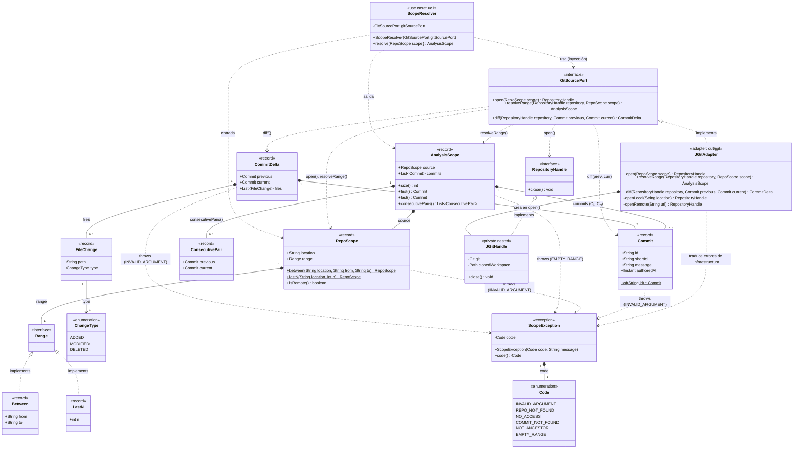

# Diagrama de Clases — DDV

> 📏 Generado a partir de `src/main/java/ddv` (ver `AGENTS.md` § Reglas, regla 6).
> **Última actualización:** 2026-11-22 — estado tras T7 (validaciones y errores).

---

## Diagrama

---

## Leyenda

| Relación | Significado |
| :--- | :--- |
| `*--` | Composición (el todo posee a la parte; listas inmutables con `List.copyOf`) |
| `<\|..` | Implementación de interfaz (`Range` es *sealed*) |
| `..>` | Dependencia (uso en parámetros/retorno o lanzamiento de excepción) |
| `«record»` | Registro Java 17+: inmutable, igualdad por valor, constructores compactos validan invariantes |

## Notas de diseño

- **`Commit` no tiene `delta()`:** la Δ se calcula en el adaptador vía `GitSourcePort.diff()`; el dominio solo ensambla `CommitDelta` (discusión 2026-11-21 — evita que `Commit` dependa de infraestructura).
- **`RepositoryHandle` es opaco:** su implementación real es `JGitHandle` (clase interna privada de `JGitAdapter`); maneja `Git` y limpia el workspace temporal del clon en `close()`.
- **`JGitAdapter` traduce errores** de JGit a `ScopeException` (`REPO_NOT_FOUND` en local, `NO_ACCESS` en remoto).
- **`resolveRange()` (T5)** resuelve `A..B` (inclusivo, con `isMergedInto` → `NOT_ANCESTOR`) y últimos N (`setMaxCount` → `EMPTY_RANGE` si HEAD no existe), siempre en **orden ascendente**; `diff()` sigue pendiente hasta UC2.
- **`ScopeResolver` (T6)** orquesta `open → resolveRange → close` con *try-with-resources* mediante inyección de `GitSourcePort`; no conoce JGit ni valida directamente (validan dominio y adaptador).
- **`Code`** está anidado en `ScopeException` (`ScopeException.Code`).

### Matriz de validaciones (T7)

| Código | Origen | Causa |
| :--- | :--- | :--- |
| `INVALID_ARGUMENT` | `RepoScope` / `AnalysisScope` / `JGitAdapter` | `n ≤ 0`, origen/destino en blanco, `Commits` vacío, par con mismo commit, handle ajeno |
| `REPO_NOT_FOUND` | `JGitAdapter.open` (local) | ruta inexistente, directorio no-git, ruta que no es directorio |
| `NO_ACCESS` | `JGitAdapter.open` (remoto) / `resolveRange` | fallo de clone o red; errores inesperados al resolver el rango |
| `COMMIT_NOT_FOUND` | `JGitAdapter.resolveRange` | extremo `A` o `B` inexistente (resuelto o `MissingObjectException`) |
| `NOT_ANCESTOR` | `JGitAdapter.resolveRange` | `A` no es ancestro de `B` (`isMergedInto`) |
| `EMPTY_RANGE` | `AnalysisScope` / `JGitAdapter` | lista vacía, único commit o `A == B`; HEAD sin crear |
- **`CommitDelta`** pertenece al UC2 pero su contrato nace en T3 (firma de `GitSourcePort.diff`).

## Pendiente de implementación (no representado aún)

| Tarea | Clases futuras |
| :--- | :--- |
| T8 | `adapters/in/cli/AnalyzeCommand` (picocli) |
| UC2 | `JGitAdapter.diff()` (Δ entre commits consecutivos) |
| UC3 | `ParserPort`, `AstParserAdapter`, `StructuralChange` |
| UC4 | `RendererPort`, `MermaidRenderer`, `DiagramSpec` |
| UC5 | `StorePort`, `FileStoreAdapter`, `EvolutionComparer` |
