# Diagrama de Clases — DDV

> 📏 Generado a partir de `src/main/java/ddv` (ver `AGENTS.md` § Reglas, regla 6).
> **Última actualización:** 2026-11-23 — **UC2 completa** (U2T1–U2T8: `DeltaSequence`, `DiffException`, `JGitAdapter.diff()`, `SourceFileFilter`, `DiffExtractor`).

---

## Diagrama

```mermaid
classDiagram
    direction TB

    class Commit {
        <<record>>
        +String id
        +String shortId
        +String message
        +Instant authoredAt
        +of(String id)$ Commit
    }

    class RepoScope {
        <<record>>
        +String location
        +Range range
        +between(String location, String from, String to)$ RepoScope
        +lastN(String location, int n)$ RepoScope
        +isRemote() boolean
    }

    class Range {
        <<interface>>
    }

    class Between {
        <<record>>
        +String from
        +String to
    }

    class LastN {
        <<record>>
        +int n
    }

    class AnalysisScope {
        <<record>>
        +RepoScope source
        +List~Commit~ commits
        +size() int
        +first() Commit
        +last() Commit
        +consecutivePairs() List~ConsecutivePair~
    }

    class ConsecutivePair {
        <<record>>
        +Commit previous
        +Commit current
    }

    class CommitDelta {
        <<record>>
        +Commit previous
        +Commit current
        +List~FileChange~ files
    }

    class FileChange {
        <<record>>
        +String path
        +ChangeType type
    }

    class ChangeType {
        <<enumeration>>
        ADDED
        MODIFIED
        DELETED
    }

    class DeltaSequence {
        <<record>>
        +AnalysisScope source
        +List~CommitDelta~ deltas
        +size() int
    }

    class ScopeException {
        <<exception>>
        -Code code
        +ScopeException(Code code, String message)
        +code() Code
    }

    class Code {
        <<enumeration>>
        INVALID_ARGUMENT
        REPO_NOT_FOUND
        NO_ACCESS
        COMMIT_NOT_FOUND
        NOT_ANCESTOR
        EMPTY_RANGE
    }

    class DiffException {
        <<exception>>
        -Code code
        +DiffException(Code code, String message)
        +code() Code
    }

    class DiffCode {
        <<enumeration: DiffException.Code>>
        INVALID_ARGUMENT
        IO_ERROR
        UNSUPPORTED
    }

    class GitSourcePort {
        <<interface>>
        +open(RepoScope scope) RepositoryHandle
        +resolveRange(RepositoryHandle repository, RepoScope scope) AnalysisScope
        +diff(RepositoryHandle repository, Commit previous, Commit current) CommitDelta
    }

    class RepositoryHandle {
        <<interface>>
        +close() void
    }

    class JGitAdapter {
        <<adapter: out/jgit>>
        +open(RepoScope scope) RepositoryHandle
        +resolveRange(RepositoryHandle repository, RepoScope scope) AnalysisScope
        +diff(RepositoryHandle repository, Commit previous, Commit current) CommitDelta
        -openLocal(String location) RepositoryHandle
        -openRemote(String url) RepositoryHandle
        -scanChanges(Repository repository, String previousId, String currentId) List~FileChange~
        -treeOf(RevWalk walk, Repository repository, String id) RevTree
        -toFileChanges(DiffEntry entry) List~FileChange~
    }

    class JGitHandle {
        <<private nested>>
        -Git git
        -Path clonedWorkspace
        +close() void
    }

    class ScopeResolver {
        <<application: scope>>
        -GitSourcePort gitSourcePort
        +ScopeResolver(GitSourcePort gitSourcePort)
        +resolve(RepoScope scope) AnalysisScope
    }

    class SourceFileFilter {
        <<application: pipeline>>
        +Set~String~ extensions
        +javaFiles()$ SourceFileFilter
        +filter(List~FileChange~ changes) List~FileChange~
        +isRelevant(FileChange change) boolean
    }

    class DiffExtractor {
        <<use case: pipeline (UC2)>>
        -GitSourcePort gitSourcePort
        -SourceFileFilter sourceFileFilter
        +DiffExtractor(GitSourcePort gitSourcePort, SourceFileFilter sourceFileFilter)
        +extract(AnalysisScope scope) DeltaSequence
        +relevantChanges(DeltaSequence sequence) List~FileChange~
    }

    class AnalyzeCommand {
        <<adapter: in/cli>>
        +AnalyzeCommand(ScopeResolver scopeResolver)
        +call() Integer
        -toRepoScope() RepoScope
        -describe(Range range) String
    }

    class RangeArgs {
        <<private nested>>
        +String range
        +Integer last
    }

    class DdvCommand {
        <<entry point: in/cli>>
        +run() void
        +main(String[] args)$ void
        -execute(String[] args)$ int
        -execute(String[] args, PrintWriter out, PrintWriter err)$ int
    }

    %% Composición del dominio
    AnalysisScope "1" *-- "0..*" Commit : commits (C₁..Cₙ)
    AnalysisScope "1" *-- "1" RepoScope : source
    AnalysisScope "1" *-- "0..*" ConsecutivePair : consecutivePairs()
    CommitDelta "1" *-- "2" Commit : previous, current
    CommitDelta "1" *-- "0..*" FileChange : files
    FileChange "1" --> "1" ChangeType : type
    RepoScope "1" *-- "1" Range : range
    Range <|.. Between : implements
    Range <|.. LastN : implements
    ScopeException "1" *-- "1" Code : code
    DiffException "1" *-- "1" DiffCode : code

    %% Secuencia de Δ — salida del UC2 (U2T1)
    DeltaSequence "1" *-- "1" AnalysisScope : source (trazabilidad)
    DeltaSequence "1" *-- "0..*" CommitDelta : deltas (una por par)

    %% El puerto depende solo de tipos de dominio
    GitSourcePort ..> RepoScope : open(), resolveRange()
    GitSourcePort ..> RepositoryHandle : open()
    GitSourcePort ..> AnalysisScope : resolveRange()
    GitSourcePort ..> Commit : diff(prev, curr)
    GitSourcePort ..> CommitDelta : diff()

    %% Adaptador de salida (T4)
    GitSourcePort <|.. JGitAdapter : implements
    RepositoryHandle <|.. JGitHandle : implements
    JGitAdapter *-- JGitHandle : crea en open()
    JGitAdapter ..> ScopeException : traduce errores de infraestructura
    JGitAdapter ..> DiffException : traduce errores de diff

    %% Caso de uso UC1 (T6)
    ScopeResolver ..> GitSourcePort : usa (inyección)
    ScopeResolver ..> RepoScope : entrada
    ScopeResolver ..> AnalysisScope : salida

    %% Filtro de relevancia del UC2 (U2T4)
    SourceFileFilter ..> CommitDelta : selecciona files analizables

    %% Caso de uso UC2 (U2T5)
    DiffExtractor ..> GitSourcePort : usa (inyección)
    DiffExtractor ..> AnalysisScope : entrada (contrato de UC1)
    DiffExtractor ..> DeltaSequence : salida (una Δ por par)
    DiffExtractor ..> SourceFileFilter : inyecta el filtro de lenguaje
    DiffExtractor ..> CommitDelta : relevantChanges() para UC3

    %% Adaptador de entrada (T8)
    DdvCommand *-- AnalyzeCommand : registra subcomando
    DdvCommand ..> ScopeResolver : ensambla (raíz de composición)
    AnalyzeCommand ..> ScopeResolver : invoca (inyección)
    AnalyzeCommand ..> RepoScope : traduce argumentos CLI a
    AnalyzeCommand ..> ScopeException : captura → exit 1
    AnalyzeCommand *-- RangeArgs : ArgGroup exclusivo (--range | --last)

    %% Invariantes: constructores compactos lanzan excepciones tipadas
    Commit ..> ScopeException : throws (INVALID_ARGUMENT)
    RepoScope ..> ScopeException : throws (INVALID_ARGUMENT)
    AnalysisScope ..> ScopeException : throws (EMPTY_RANGE)
    CommitDelta ..> DiffException : throws (INVALID_ARGUMENT)
    DeltaSequence ..> DiffException : throws (alineación)
```

---

## Leyenda

| Relación | Significado |
| :--- | :--- |
| `*--` | Composición (el todo posee a la parte; listas inmutables con `List.copyOf`) |
| `<\|..` | Implementación de interfaz (`Range` es *sealed*) |
| `..>` | Dependencia (uso en parámetros/retorno o lanzamiento de excepción) |
| `«record»` | Registro Java 17+: inmutable, igualdad por valor, constructores compactos validan invariantes |

## Notas de diseño

- **`Commit` no tiene `delta()`:** la Δ se calcula en el adaptador vía `GitSourcePort.diff()`; el dominio solo ensambla `CommitDelta` (discusión 2026-11-21 — evita que `Commit` dependa de infraestructura).
- **`CommitDelta`** pertenece al UC2 pero su contrato nace en T3 (firma de `GitSourcePort.diff`).
- **`RepositoryHandle` es opaco:** su implementación real es `JGitHandle` (clase interna privada de `JGitAdapter`); maneja `Git` y limpia el workspace temporal del clon en `close()`.
- **`JGitAdapter` traduce errores** de JGit a `ScopeException` (`REPO_NOT_FOUND` en local, `NO_ACCESS` en remoto).
- **`resolveRange()` (T5)** resuelve `A..B` (inclusivo, con `isMergedInto` → `NOT_ANCESTOR`) y últimos N (`setMaxCount` → `EMPTY_RANGE` si HEAD no existe), siempre en **orden ascendente**.
- **`diff()` (U2T3)** compara los árboles de `previous` y `current` con `DiffFormatter` (`setDetectRenames(true)`) y mapea `ADD/MODIFY/DELETE` a `ChangeType`; un **rename se emite como `DELETED`(origen) + `ADDED`(destino)** y `COPY` → `UNSUPPORTED`. `DiffCommand` de JGit no expone detección de renames, por eso se usa `DiffFormatter.scan()`.
- **`ScopeResolver` (T6)** orquesta `open → resolveRange → close` con *try-with-resources* mediante inyección de `GitSourcePort`; no conoce JGit ni valida directamente (validan dominio y adaptador).
- **`AnalyzeCommand` (T8)** es el adaptador de entrada: `Callable<Integer>` de picocli con `@Spec` para escribir por los *writers* de la `CommandLine` (testeable sin capturar `System.out`). Salidas: **exit 0** (ok), **exit 1** (`ScopeException` → `Error [CÓDIGO]: mensaje` por stderr), **exit 2** (errores de uso de picocli: faltan/exclusivas opciones o `--range` sin `..`).
- **`DdvCommand` (T8)** es la raíz de composición: único punto que junta `JGitAdapter` + `ScopeResolver`; con la raíz sin subcomando imprime la ayuda. El overload `execute(args, out, err)` (T10) es la costura testeable para el E2E: propaga los *writers* a los subcomandos porque picocli no lo hace (cada subcomando tiene su propia `CommandLine`).
- **`AnalysisScope` es contrato estable (T9):** UC2–UC4 se apoyan en orden ascendente, inmutabilidad y `consecutivePairs()` en el mismo orden. Bloqueado por `AnalysisScopeTest` (instancias idénticas, pares inmutables, trazabilidad `source`, igualdad por valor) y `GitSourcePortContractTest` (reproduce la cabecera del bucle `open → diff(par) → close` contra un puerto falso).
- **`DeltaSequence` es contrato de salida de UC2 (U2T1):** una Δ por par, alineada 1:1 y en el mismo orden que `consecutivePairs()` (el invariante se valida en el constructor → `DiffException`), inmutable y trazable al `AnalysisScope` de origen; UC3 la recorre sin código adhesivo. Bloqueado por `DeltaSequenceTest` y `DeltaSequenceContractTest` (U2T6: alimenta a un analizador falso con (par, Δ) y verifica `relevantChanges()`).
- **`DiffException` (U2T2)** separa los fallos de detección de Δ de `ScopeException` (alcance, UC1): `FileChange` migró a ella. Cada excepción nombra la preocupación que representa.
- **`SourceFileFilter` (U2T4)** decide qué archivos del Δ parsea UC3, pero solo por **extensión** (`.java` para el MVP; configurable, p. ej. `.py`): la relevancia estructural real la determina UC3 sobre el AST. Es inyectable para que el lenguaje no esté cableado en el pipeline.
- **`DiffExtractor` (U2T5)** es el caso de uso UC2: `open → diff(par) → close` sobre `consecutivePairs()`, ensamblando `DeltaSequence` (el invariante de alineación del record detecta un puerto que devuelva Δs fuera de orden). `relevantChanges()` entrega a UC3 la lista plana de archivos analizables, en orden de aparición.
- **`Code`** está anidado en `ScopeException`; `DiffException` tiene el suyo propio (representado como `DiffCode` para no colisionar en el diagrama).
- **Paquetes de `application` nombrados por concepto, no por número de UC** (`scope`, `evolution`, `pipeline`): el número es volátil y no dice nada en un import; el caso de uso se referencia en la documentación (`docs/UC-diagram.md`).

### Matriz de validaciones (T7)

| Código | Origen | Causa |
| :--- | :--- | :--- |
| `INVALID_ARGUMENT` | `RepoScope` / `AnalysisScope` / `JGitAdapter` | `n ≤ 0`, origen/destino en blanco, `Commits` vacío, handle ajeno |
| `REPO_NOT_FOUND` | `JGitAdapter.open` (local) | ruta inexistente, directorio no-git, ruta que no es directorio |
| `NO_ACCESS` | `JGitAdapter.open` (remoto) / `resolveRange` | fallo de clone o red; errores inesperados al resolver el rango |
| `COMMIT_NOT_FOUND` | `JGitAdapter.resolveRange` | extremo `A` o `B` inexistente (resuelto o `MissingObjectException`) |
| `NOT_ANCESTOR` | `JGitAdapter.resolveRange` | `A` no es ancestro de `B` (`isMergedInto`) |
| `EMPTY_RANGE` | `AnalysisScope` / `JGitAdapter` | lista vacía, único commit o `A == B`; HEAD sin crear |

### Matriz de validaciones — `DiffException` (U2T2)

| Código | Origen | Causa |
| :--- | :--- | :--- |
| `INVALID_ARGUMENT` | `CommitDelta.FileChange` / `DeltaSequence` / `JGitAdapter.diff` | ruta en blanco; nº de Δ ≠ nº de pares; Δ fuera de orden respecto a los pares; handle ajeno |
| `IO_ERROR` | `JGitAdapter.diff` | commit inexistente en el repositorio o fallo de lectura al comparar árboles |
| `UNSUPPORTED` | `JGitAdapter.diff` | tipo de cambio `COPY` (no soportado por el MVP) |

## Pendiente de implementación (no representado aún)

| Tarea | Clases futuras |
| :--- | :--- |
| UC3 | `ParserPort`, `AstParserAdapter`, `StructuralChange` |
| UC4 | `RendererPort`, `MermaidRenderer`, `DiagramSpec` |
| UC5 | `StorePort`, `FileStoreAdapter`, `EvolutionComparer` |
