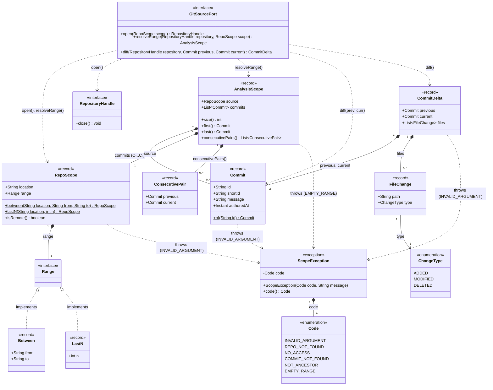

# Diagrama de Clases — DDV

> 📏 Generado a partir de `src/main/java/ddv` (ver `AGENTS.md` § Reglas, regla 6).
> **Última actualización:** 2026-11-21 — estado tras T3 (`GitSourcePort`).

---

## Diagrama

---

## Leyenda

| Relación | Significado |
| :--- | :--- |
| `*--` | Composición (el todo posee a la parte; listas inmutables con `List.copyOf`) |
| `<\|..` | Implementación de interfaz (`Range` es *sealed*) |
| `..>` | Dependencia (uso en parámetros/retorno o lanzamiento de excepción) |
| `«record»` | Registro Java 17+: inmutable, igualdad por valor, constructores compactos validan invariantes |

## Notas de diseño

- **`Commit` no tiene `delta()`:** la Δ se calcula en el adaptador vía `GitSourcePort.diff()`; el dominio solo ensambla `CommitDelta` (discusión 2026-11-21 — evita que `Commit` dependa de infraestructura).
- **`RepositoryHandle` es opaco:** la implementación real (JGit) se oculta en `adapters/out/jgit` (T4); el núcleo solo lo ve como `AutoCloseable`.
- **`Code`** está anidado en `ScopeException` (`ScopeException.Code`).
- **`CommitDelta`** pertenece al UC2 pero su contrato nace en T3 (firma de `GitSourcePort.diff`).

## Pendiente de implementación (no representado aún)

| Tarea | Clases futuras |
| :--- | :--- |
| T4–T5 | `adapters/out/jgit/JGitAdapter` (implementa `GitSourcePort`, `RepositoryHandle`) |
| T6 | `application/uc1/ScopeResolver` |
| T7 | validaciones completas de `ScopeException` |
| T8 | `adapters/in/cli/AnalyzeCommand` (picocli) |
| UC3 | `ParserPort`, `AstParserAdapter`, `StructuralChange` |
| UC4 | `RendererPort`, `MermaidRenderer`, `DiagramSpec` |
| UC5 | `StorePort`, `FileStoreAdapter`, `EvolutionComparer` |
