# Diagrama de Clases — DDV

> 📏 Generado a partir de `src/main/java/ddv` (ver `AGENTS.md` § Reglas, regla 6).
> **Última actualización:** 2026-11-24 — **UC2 completa** (U2T1–U2T8: `DeltaSequence`, `DiffException`, `JGitAdapter.diff()`, `SourceFileFilter`, `DiffExtractor`) y revisión de calidad (`SourceFileFilter` normaliza y valida sus extensiones, `Commit.SHORT_ID_LENGTH`, `JGitAdapter` sin métodos >30 líneas ni bloques internos duplicados). **UC3 U3T1–U3T7:** `CodeStructure`, `StructuralChange`/`StructuralSequence` (Sᵢ), `ParseException`, `GitSourcePort.content()` (U3T2), `ParserPort` + `AstParserAdapter` (U3T4), `StructuralAnalyzer` (U3T5), contrato UC3 → UC4 (U3T6) y E2E (U3T7).

---

## Diagrama

```mermaid
classDiagram
    direction TB

    class Commit {
        <<record>>
        +String id
        +String shortId
        +String message
        +Instant authoredAt
        -SHORT_ID_LENGTH int
        +of(String id)$ Commit
    }

    class RepoScope {
        <<record>>
        +String location
        +Range range
        +between(String location, String from, String to)$ RepoScope
        +lastN(String location, int n)$ RepoScope
        +isRemote() boolean
    }

    class Range {
        <<interface>>
    }

    class Between {
        <<record>>
        +String from
        +String to
    }

    class LastN {
        <<record>>
        +int n
    }

    class AnalysisScope {
        <<record>>
        +RepoScope source
        +List~Commit~ commits
        +size() int
        +first() Commit
        +last() Commit
        +consecutivePairs() List~ConsecutivePair~
    }

    class ConsecutivePair {
        <<record>>
        +Commit previous
        +Commit current
    }

    class CommitDelta {
        <<record>>
        +Commit previous
        +Commit current
        +List~FileChange~ files
    }

    class FileChange {
        <<record>>
        +String path
        +ChangeType type
    }

    class ChangeType {
        <<enumeration>>
        ADDED
        MODIFIED
        DELETED
    }

    class DeltaSequence {
        <<record>>
        +AnalysisScope source
        +List~CommitDelta~ deltas
        +size() int
    }

    class CodeStructure {
        <<record>>
        +List~String~ imports
        +List~ClassStructure~ classes
    }

    class ClassStructure {
        <<nested: CodeStructure>>
        +String name
        +ClassKind kind
        +List~String~ superTypes
        +List~MemberStructure~ members
        +List~String~ typeUsages
    }

    class MemberStructure {
        <<nested: CodeStructure>>
        +String name
        +MemberKind kind
        +List~String~ parameterTypes
    }

    class ClassKind {
        <<enumeration: CodeStructure.ClassKind>>
        CLASS
        INTERFACE
        ENUM
        RECORD
        ANNOTATION
    }

    class MemberKind {
        <<enumeration: CodeStructure.MemberKind>>
        METHOD
        FIELD
    }

    class StructuralChange {
        <<record: Sᵢ>>
        +CommitDelta delta
        +List~FileStructureChange~ files
    }

    class StructuralSequence {
        <<record>>
        +DeltaSequence source
        +List~StructuralChange~ changes
        +size() int
    }

    class FileStructureChange {
        <<nested: StructuralChange>>
        +String path
        +List~ClassChange~ classes
    }

    class ClassChange {
        <<nested: StructuralChange>>
        +String name
        +ChangeKind kind
        +List~MemberStructure~ addedMembers
        +List~MemberStructure~ removedMembers
        +List~String~ addedDependencies
        +List~String~ removedDependencies
    }

    class ChangeKind {
        <<enumeration: StructuralChange.ChangeKind>>
        ADDED
        MODIFIED
        REMOVED
    }

    class ScopeException {
        <<exception>>
        -Code code
        +ScopeException(Code code, String message)
        +code() Code
    }

    class Code {
        <<enumeration>>
        INVALID_ARGUMENT
        REPO_NOT_FOUND
        NO_ACCESS
        COMMIT_NOT_FOUND
        NOT_ANCESTOR
        EMPTY_RANGE
    }

    class DiffException {
        <<exception>>
        -Code code
        +DiffException(Code code, String message)
        +code() Code
    }

    class DiffCode {
        <<enumeration: DiffException.Code>>
        INVALID_ARGUMENT
        IO_ERROR
        UNSUPPORTED
    }

    class ParseException {
        <<exception>>
        -Code code
        +ParseException(Code code, String message)
        +code() Code
        +requireNotBlank(String value, String message)$ void
    }

    class ParseCode {
        <<enumeration: ParseException.Code>>
        SYNTAX_ERROR
        INVALID_INPUT
    }

    class GitSourcePort {
        <<interface>>
        +open(RepoScope scope) RepositoryHandle
        +resolveRange(RepositoryHandle repository, RepoScope scope) AnalysisScope
        +diff(RepositoryHandle repository, Commit previous, Commit current) CommitDelta
        +content(RepositoryHandle repository, Commit commit, String path) Optional~String~
    }

    class RepositoryHandle {
        <<interface>>
        +close() void
    }

    class ParserPort {
        <<interface>>
        +parse(String path, String source) CodeStructure
    }

    class AstParserAdapter {
        <<adapter: out/ast>>
        -JavaParser parser
        +parse(String path, String source) CodeStructure
        -compilationUnitOf(String path, String source) CompilationUnit
        -structureOf(TypeDeclaration~?~ type, String name) ClassStructure
        -membersOf(TypeDeclaration~?~ type) List~MemberStructure~
        -usagesOf(TypeDeclaration~?~ type) List~String~
        -direct(TypeDeclaration~?~ type, Class~T~ kind) List~T~
    }

    class JGitAdapter {
        <<adapter: out/jgit>>
        +open(RepoScope scope) RepositoryHandle
        +resolveRange(RepositoryHandle repository, RepoScope scope) AnalysisScope
        +diff(RepositoryHandle repository, Commit previous, Commit current) CommitDelta
        +content(RepositoryHandle repository, Commit commit, String path) Optional~String~
        -UNSUPPORTED_HANDLE String
        -openLocal(String location) RepositoryHandle
        -openRemote(String url) RepositoryHandle
        -jgitHandleOf(RepositoryHandle repository) Optional~JGitHandle~
        -noAccess(Exception cause) ScopeException
        -resolveLastN(Git git, int n) List~Commit~
        -resolveBetween(Git git, Between range) List~Commit~
        -requireResolvable(Repository repository, String revision) ObjectId
        -requireAncestralStart(Repository repository, Between range, ObjectId fromId, ObjectId toId) Commit
        -toChronological(LogCommand log) List~Commit~
        -parseCommit(RevWalk walk, AnyObjectId id, String label) RevCommit
        -toDomain(RevCommit commit) Commit
        -ioError(Exception cause, String detail) DiffException
        -scanChanges(Repository repository, String previousId, String currentId) List~FileChange~
        -treeOf(RevWalk walk, Repository repository, String id) RevTree
        -blobAt(Repository repository, RevWalk walk, String commitId, String path) Optional~String~
        -toFileChanges(DiffEntry entry) List~FileChange~
        -deleteRecursively(Path root) void
    }

    class JGitHandle {
        <<private nested>>
        -Git git
        -Path clonedWorkspace
        +close() void
    }

    class ScopeResolver {
        <<application: scope>>
        -GitSourcePort gitSourcePort
        +ScopeResolver(GitSourcePort gitSourcePort)
        +resolve(RepoScope scope) AnalysisScope
    }

    class SourceFileFilter {
        <<application: pipeline>>
        +Set~String~ extensions
        +javaFiles()$ SourceFileFilter
        +filter(List~FileChange~ changes) List~FileChange~
        +isRelevant(FileChange change) boolean
    }

    class DiffExtractor {
        <<use case: pipeline (UC2)>>
        -GitSourcePort gitSourcePort
        -SourceFileFilter sourceFileFilter
        +DiffExtractor(GitSourcePort gitSourcePort, SourceFileFilter sourceFileFilter)
        +extract(AnalysisScope scope) DeltaSequence
        +relevantChanges(DeltaSequence sequence) List~FileChange~
    }

    class StructuralAnalyzer {
        <<use case: pipeline (UC3)>>
        -GitSourcePort gitSourcePort
        -ParserPort parserPort
        -SourceFileFilter sourceFileFilter
        +StructuralAnalyzer(GitSourcePort gitSourcePort, ParserPort parserPort, SourceFileFilter sourceFileFilter)
        +analyze(DeltaSequence sequence) StructuralSequence
        -analyzeDelta(RepositoryHandle handle, CommitDelta delta) StructuralChange
        -analyzeFile(RepositoryHandle handle, CommitDelta delta, FileChange change) FileStructureChange
        -structureAt(RepositoryHandle handle, Commit commit, String path) CodeStructure
    }

    class AnalyzeCommand {
        <<adapter: in/cli>>
        +AnalyzeCommand(ScopeResolver scopeResolver)
        +call() Integer
        -toRepoScope() RepoScope
        -describe(Range range) String
    }

    class RangeArgs {
        <<private nested>>
        +String range
        +Integer last
    }

    class DdvCommand {
        <<entry point: in/cli>>
        +run() void
        +main(String[] args)$ void
        -execute(String[] args)$ int
        -execute(String[] args, PrintWriter out, PrintWriter err)$ int
    }

    %% Composición del dominio
    AnalysisScope "1" *-- "0..*" Commit : commits (C₁..Cₙ)
    AnalysisScope "1" *-- "1" RepoScope : source
    AnalysisScope "1" *-- "0..*" ConsecutivePair : consecutivePairs()
    CommitDelta "1" *-- "2" Commit : previous, current
    CommitDelta "1" *-- "0..*" FileChange : files
    FileChange "1" --> "1" ChangeType : type
    RepoScope "1" *-- "1" Range : range
    Range <|.. Between : implements
    Range <|.. LastN : implements
    ScopeException "1" *-- "1" Code : code
    DiffException "1" *-- "1" DiffCode : code
    ParseException "1" *-- "1" ParseCode : code

    %% Secuencia de Δ — salida del UC2 (U2T1)
    DeltaSequence "1" *-- "1" AnalysisScope : source (trazabilidad)
    DeltaSequence "1" *-- "0..*" CommitDelta : deltas (una por par)

    %% Modelos de estructura — salida del UC3 (U3T1, U3T5)
    CodeStructure "1" *-- "0..*" ClassStructure : classes
    ClassStructure "1" *-- "0..*" MemberStructure : members
    ClassStructure "1" --> "1" ClassKind : kind
    MemberStructure "1" --> "1" MemberKind : kind
    StructuralChange "1" *-- "1" CommitDelta : delta (procedencia)
    StructuralChange "1" *-- "0..*" FileStructureChange : files (Sᵢ)
    FileStructureChange "1" *-- "0..*" ClassChange : classes
    FileStructureChange ..> CodeStructure : between(before, after)
    ClassChange "1" --> "1" ChangeKind : kind
    ClassChange "1" *-- "0..*" MemberStructure : added / removed members
    StructuralSequence "1" *-- "1" DeltaSequence : source (trazabilidad)
    StructuralSequence "1" *-- "0..*" StructuralChange : changes (uno por Δ)
    StructuralSequence ..> DiffException : throws (alineación)

    %% El puerto depende solo de tipos de dominio
    GitSourcePort ..> RepoScope : open(), resolveRange()
    GitSourcePort ..> RepositoryHandle : open()
    GitSourcePort ..> AnalysisScope : resolveRange()
    GitSourcePort ..> Commit : diff(prev, curr)
    GitSourcePort ..> CommitDelta : diff()
    GitSourcePort ..> Optional : content()
    ParserPort ..> CodeStructure : parse()

    %% Adaptador de salida (T4)
    GitSourcePort <|.. JGitAdapter : implements
    RepositoryHandle <|.. JGitHandle : implements
    JGitAdapter *-- JGitHandle : crea en open()
    JGitAdapter ..> ScopeException : traduce errores de infraestructura
    JGitAdapter ..> DiffException : traduce errores de diff

    %% Adaptador de AST (U3T4)
    ParserPort <|.. AstParserAdapter : implements
    AstParserAdapter ..> ParseException : errores de sintaxis
    AstParserAdapter ..> CodeStructure : produce la instantánea

    %% Caso de uso UC1 (T6)
    ScopeResolver ..> GitSourcePort : usa (inyección)
    ScopeResolver ..> RepoScope : entrada
    ScopeResolver ..> AnalysisScope : salida

    %% Filtro de relevancia del UC2 (U2T4)
    SourceFileFilter ..> CommitDelta : selecciona files analizables

    %% Caso de uso UC2 (U2T5)
    DiffExtractor ..> GitSourcePort : usa (inyección)
    DiffExtractor ..> AnalysisScope : entrada (contrato de UC1)
    DiffExtractor ..> DeltaSequence : salida (una Δ por par)
    DiffExtractor ..> SourceFileFilter : inyecta el filtro de lenguaje
    DiffExtractor ..> CommitDelta : relevantChanges() para UC3

    %% Caso de uso UC3 (U3T5)
    StructuralAnalyzer ..> GitSourcePort : usa (inyección)
    StructuralAnalyzer ..> ParserPort : parsea versión vieja y nueva
    StructuralAnalyzer ..> SourceFileFilter : inyecta el filtro de lenguaje
    StructuralAnalyzer ..> DeltaSequence : entrada (contrato de UC2)
    StructuralAnalyzer ..> StructuralSequence : salida (Sᵢ por Δ)
    StructuralAnalyzer ..> FileStructureChange : resta las estructuras

    %% Adaptador de entrada (T8)
    DdvCommand *-- AnalyzeCommand : registra subcomando
    DdvCommand ..> ScopeResolver : ensambla (raíz de composición)
    AnalyzeCommand ..> ScopeResolver : invoca (inyección)
    AnalyzeCommand ..> RepoScope : traduce argumentos CLI a
    AnalyzeCommand ..> ScopeException : captura → exit 1
    AnalyzeCommand *-- RangeArgs : ArgGroup exclusivo (--range | --last)

    %% Invariantes: constructores compactos lanzan excepciones tipadas
    Commit ..> ScopeException : throws (INVALID_ARGUMENT)
    RepoScope ..> ScopeException : throws (INVALID_ARGUMENT)
    AnalysisScope ..> ScopeException : throws (EMPTY_RANGE)
    CommitDelta ..> DiffException : throws (INVALID_ARGUMENT)
    DeltaSequence ..> DiffException : throws (alineación)
    CodeStructure ..> ParseException : throws (INVALID_INPUT)
    StructuralChange ..> ParseException : throws (INVALID_INPUT)
```

---

## Leyenda

| Relación | Significado |
| :--- | :--- |
| `*--` | Composición (el todo posee a la parte; listas inmutables con `List.copyOf`) |
| `<\|..` | Implementación de interfaz (`Range` es *sealed*) |
| `..>` | Dependencia (uso en parámetros/retorno o lanzamiento de excepción) |
| `«record»` | Registro Java 17+: inmutable, igualdad por valor, constructores compactos validan invariantes |

## Notas de diseño

- **`Commit` no tiene `delta()`:** la Δ se calcula en el adaptador vía `GitSourcePort.diff()`; el dominio solo ensambla `CommitDelta` (discusión 2026-11-21 — evita que `Commit` dependa de infraestructura).
- **`CommitDelta`** pertenece al UC2 pero su contrato nace en T3 (firma de `GitSourcePort.diff`).
- **`RepositoryHandle` es opaco:** su implementación real es `JGitHandle` (clase interna privada de `JGitAdapter`); maneja `Git` y limpia el workspace temporal del clon en `close()`.
- **`JGitAdapter` traduce errores** de JGit a `ScopeException` (`REPO_NOT_FOUND` en local, `NO_ACCESS` en remoto). La traducción vive en `noAccess()` / `ioError()`: conservan los fallos ya tipados por el adaptador y envuelven solo lo inesperado; el handle ajeno se rechaza una sola vez en `jgitHandleOf()` con `INVALID_ARGUMENT` y el mensaje `UNSUPPORTED_HANDLE`, eligiendo la excepción que corresponde al caso de uso.
- **`resolveRange()` (T5)** resuelve `A..B` (inclusivo, con `isMergedInto` → `NOT_ANCESTOR`) y últimos N (`setMaxCount` → `EMPTY_RANGE` si HEAD no existe), siempre en **orden ascendente**.
- **`diff()` (U2T3)** compara los árboles de `previous` y `current` con `DiffFormatter` (`setDetectRenames(true)`) y mapea `ADD/MODIFY/DELETE` a `ChangeType`; un **rename se emite como `DELETED`(origen) + `ADDED`(destino)** y `COPY` → `UNSUPPORTED`. `DiffCommand` de JGit no expone detección de renames, por eso se usa `DiffFormatter.scan()`.
- **`content()` (U3T2)** lee el blob de un archivo **en un commit concreto** (`TreeWalk.forPath` + `ObjectLoader`, UTF-8) y devuelve `Optional.empty()` si no existía en ese commit o si la ruta es un directorio — JGit devuelve en ese caso el *árbol*, no `null`, así que se comprueba `getFileMode == OBJ_BLOB` (cubierto por test). Reutiliza `treeOf()` e `ioError()` con `diff()`; es lo que UC3 usa para parsear la versión vieja y la nueva de cada Δ.
- **`AstParserAdapter` (U3T4)** implementa `ParserPort` con **JavaParser** a nivel `JAVA_25` (sin configurarlo rechaza `record`, que exige ≥14). Produce `CodeStructure` por nombre, **sin resolución de símbolos** (no hay classpath): `superTypes` de `extends`/`implements`, `typeUsages` excluyendo los de clases anidadas y los ya registrados como superTypes, y miembros directos (métodos, constructores, atributos, constantes de enum, componentes de record). El despacho sobre `TypeDeclaration` —jerarquía **abierta de un tercero**— usa `switch` de patrones con `default` que **lanza** (`SYNTAX_ERROR`), no un caso silencioso; los tipos propios van *sealed* sin `default` (reglas de `refactors.md` C).
- **`StructuralAnalyzer` (U3T5)** es el caso de uso UC3: por cada Δ abre el repo, lee con `content()` la versión vieja y la nueva de cada `.java`, las parsea y delega la resta en `FileStructureChange.between(before, after)` — lógica pura de dominio, testeable sin mocks. **La presencia del contenido** (viejo vacío → clase dada de alta) sustituye a cualquier `switch` sobre `CommitDelta.ChangeType` (la E7 del inventario de `refactors.md` no llegó a materializarse). **`StructuralChange`** lleva ahora su Δ de origen y **`StructuralSequence`** valida la alineación 1:1 (mismo patrón y misma excepción que `DeltaSequence`). Bloqueado por `StructuralSequenceTest` y por `StructuralSequenceContractTest` (U3T6), que alimenta a un **generador de diagramas falso** con la salida real del analizador y verifica que UC4 recibe, sin código adhesivo, un diagrama por Δ en orden con sus commits, clases, miembros y dependencias añadidos.
- **`ScopeResolver` (T6)** orquesta `open → resolveRange → close` con *try-with-resources* mediante inyección de `GitSourcePort`; no conoce JGit ni valida directamente (validan dominio y adaptador).
- **`AnalyzeCommand` (T8)** es el adaptador de entrada: `Callable<Integer>` de picocli con `@Spec` para escribir por los *writers* de la `CommandLine` (testeable sin capturar `System.out`). Salidas: **exit 0** (ok), **exit 1** (`ScopeException` → `Error [CÓDIGO]: mensaje` por stderr), **exit 2** (errores de uso de picocli: faltan/exclusivas opciones o `--range` sin `..`).
- **`DdvCommand` (T8)** es la raíz de composición: único punto que junta `JGitAdapter` + `ScopeResolver`; con la raíz sin subcomando imprime la ayuda. El overload `execute(args, out, err)` (T10) es la costura testeable para el E2E: propaga los *writers* a los subcomandos porque picocli no lo hace (cada subcomando tiene su propia `CommandLine`).
- **`AnalysisScope` es contrato estable (T9):** UC2–UC4 se apoyan en orden ascendente, inmutabilidad y `consecutivePairs()` en el mismo orden. Bloqueado por `AnalysisScopeTest` (instancias idénticas, pares inmutables, trazabilidad `source`, igualdad por valor) y `GitSourcePortContractTest` (reproduce la cabecera del bucle `open → diff(par) → close` contra un puerto falso).
- **`DeltaSequence` es contrato de salida de UC2 (U2T1):** una Δ por par, alineada 1:1 y en el mismo orden que `consecutivePairs()` (el invariante se valida en el constructor → `DiffException`), inmutable y trazable al `AnalysisScope` de origen; UC3 la recorre sin código adhesivo. Bloqueado por `DeltaSequenceTest` y `DeltaSequenceContractTest` (U2T6: alimenta a un analizador falso con (par, Δ) y verifica `relevantChanges()`).
- **`DiffException` (U2T2)** separa los fallos de detección de Δ de `ScopeException` (alcance, UC1): `FileChange` migró a ella. Cada excepción nombra la preocupación que representa.
- **`CodeStructure` y `StructuralChange` (U3T1)** son los modelos de UC3: el parser produce una instantánea neutra por archivo (`imports`, clases con sus miembros, `superTypes` y `typeUsages`) y el caso de uso **resta** la versión vieja contra la nueva para producir $S_i$ por archivo. En `ClassChange`, una clase `ADDED` lista todos sus miembros en `addedMembers` (y viceversa en `REMOVED`); las dependencias siguen la decisión 4: `import` + `extends`/`implements` + tipos de firmas y cuerpos, **sin resolución de símbolos** (por nombre, desambiguado con los `import` locales).
- **`ParseException` (U3T3)** es la tercera excepción tipada: `SYNTAX_ERROR` (sintaxis) e `INVALID_INPUT` (textos en blanco, vía el validador estático `requireNotBlank`).
- **`SourceFileFilter` (U2T4)** decide qué archivos del Δ parsea UC3, pero solo por **extensión** (`.java` para el MVP; configurable, p. ej. `.py`): la relevancia estructural real la determina UC3 sobre el AST. Es inyectable para que el lenguaje no esté cableado en el pipeline. El constructor **normaliza** las extensiones (minúsculas, para que la coincidencia `endsWith` sea insensible a mayúsculas en ambos lados) y **valida** que lleven punto (`INVALID_ARGUMENT` en caso contrario); las que solo difieren en mayúsculas se deduplican.
- **`DiffExtractor` (U2T5)** es el caso de uso UC2: `open → diff(par) → close` sobre `consecutivePairs()`, ensamblando `DeltaSequence` (el invariante de alineación del record detecta un puerto que devuelva Δs fuera de orden). `relevantChanges()` entrega a UC3 la lista plana de archivos analizables, en orden de aparición.
- **`Code`** está anidado en `ScopeException`; `DiffException` y `ParseException` tienen el suyo propio (representados como `DiffCode` y `ParseCode` para no colisionar en el diagrama).
- **Paquetes de `application` nombrados por concepto, no por número de UC** (`scope`, `evolution`, `pipeline`): el número es volátil y no dice nada en un import; el caso de uso se referencia en la documentación (`docs/UC-diagram.md`).

### Matriz de validaciones (T7)

| Código | Origen | Causa |
| :--- | :--- | :--- |
| `INVALID_ARGUMENT` | `RepoScope` / `AnalysisScope` / `JGitAdapter` | `n ≤ 0`, origen/destino en blanco, `Commits` vacío, handle ajeno |
| `REPO_NOT_FOUND` | `JGitAdapter.open` (local) | ruta inexistente, directorio no-git, ruta que no es directorio |
| `NO_ACCESS` | `JGitAdapter.open` (remoto) / `resolveRange` | fallo de clone o red; errores inesperados al resolver el rango |
| `COMMIT_NOT_FOUND` | `JGitAdapter.resolveRange` | extremo `A` o `B` inexistente (resuelto o `MissingObjectException`) |
| `NOT_ANCESTOR` | `JGitAdapter.resolveRange` | `A` no es ancestro de `B` (`isMergedInto`) |
| `EMPTY_RANGE` | `AnalysisScope` / `JGitAdapter` | lista vacía, único commit o `A == B`; HEAD sin crear |

### Matriz de validaciones — `DiffException` (U2T2)

| Código | Origen | Causa |
| :--- | :--- | :--- |
| `INVALID_ARGUMENT` | `CommitDelta.FileChange` / `DeltaSequence` / `StructuralSequence` / `SourceFileFilter` / `JGitAdapter.diff`, `.content` | ruta en blanco; nº de Δ ≠ nº de pares o Sᵢ fuera de orden respecto a sus Δ; conjunto de extensiones vacío o extensión sin punto; handle ajeno |
| `IO_ERROR` | `JGitAdapter.diff` / `JGitAdapter.content` | commit inexistente en el repositorio o fallo de lectura (comparar árboles, leer un blob) |
| `UNSUPPORTED` | `JGitAdapter.diff` | tipo de cambio `COPY` (no soportado por el MVP) |

### Matriz de validaciones — `ParseException` (U3T3)

| Código | Origen | Causa |
| :--- | :--- | :--- |
| `INVALID_INPUT` | `CodeStructure` / `StructuralChange` | nombre de clase, miembro o ruta en blanco (`requireNotBlank`) |
| `SYNTAX_ERROR` | `AstParserAdapter` | el código fuente tiene errores de sintaxis (con línea/columna) o tipo de declaración no soportado |

## Pendiente de implementación (no representado aún)

| Tarea | Clases futuras |
| :--- | :--- |
| UC4 | `RendererPort`, `MermaidRenderer`, `DiagramSpec` |
| UC5 | `StorePort`, `FileStoreAdapter`, `EvolutionComparer` |
