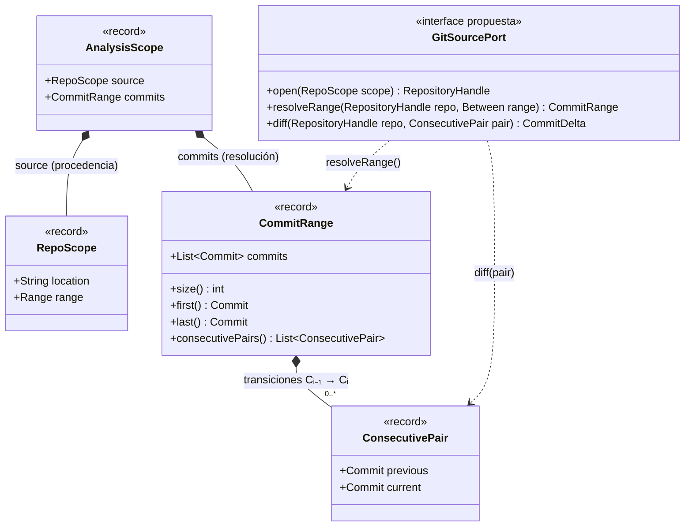

# Refactorizaciones posibles (deuda de diseño)

**Estado:** ❌ ninguna implementada — **diferidas a propósito**
**Origen:** revisión de código de 2026-11-23 + discusión de diseño posterior
**Regla de este documento:** no se anticipan. Cada entrada declara su **gatillo** — la evidencia que justificaría hacerla — y su **superficie**. Hasta que el gatillo salga, tocar ese código por otro motivo **no** activa la refactorización.

> Pendiente menor relacionado: dos `UnsupportedOperationException` en tests siguen con mensaje en español (`DeltaSequenceContractTest`, `GitSourcePortContractTest`), lo que incumple la regla 5 del `AGENTS.md`. Es corrección, no refactorización: arreglarse al tocar esos tests.

---

## A. El rango de commits como concepto propio — **revisar en UC3 / UC5**

**Señal detectada.** `domain/model/AnalysisScope.java` mezcla dos conceptos:

| Concepto | Componente | Operaciones |
| :--- | :--- | :--- |
| **Procedencia / trazabilidad** — salida del UC1, la consume UC5 | `source: RepoScope` | solo `source()` |
| **Semántica de secuencia** — lista ordenada y no vacía | `commits: List<Commit>` | `size()`, `first()`, `last()`, `consecutivePairs()` |

Toda la conducta de la clase vive en el segundo concepto; el primero solo cuelga de un accessor. Tres pruebas de que no encajan bien:

1. el propio Javadoc se titula *«Rango resuelto de commits $C_1..C_n$»* pero la clase se llama *scope*;
2. el puerto se llama `GitSourcePort.resolveRange()` y devuelve `AnalysisScope`;
3. `ConsecutivePair` está anidado en `AnalysisScope`, cuando su productor y su significado son de la **secuencia**.

No es *Feature Envy* (los métodos operan sobre su propio componente): es **baja cohesión** + envoltorio de colección sobre un `List<Commit>` crudo.

**Propuesta (versión completa):**

```java
/** Secuencia inmutable y ordenada C₁..Cₙ: no vacía, primer/último y transiciones. */
public record CommitRange(List<Commit> commits) { /* …consecutivePairs() y ConsecutivePair */ }

/** Resultado del UC1: qué alcance se pidió y con qué commits se resolvió. */
public record AnalysisScope(RepoScope source, CommitRange commits) { }   // solo trazabilidad
```

- el puerto pasa a `CommitRange resolveRange(RepositoryHandle, RepoScope.Range)` y **`ScopeResolver` adjunta la procedencia** (el puerto resuelve historia; el caso de uso ensambla);
- `ConsecutivePair` se muda a `CommitRange` — su autoridad como «adyacentes en el rango» queda con su único productor;
- la invariante `EMPTY_RANGE` cae en el tipo que la posee.

**Versión a evitar (peor que el problema):** extraer `CommitRange` dejando `size()/first()/last()/consecutivePairs()` como *forwards* en `AnalysisScope`. Añade una capa sin quitar el olor: el split solo vale si `AnalysisScope` **deja de exponer operaciones de secuencia**.

**Alternativa más radical (no recomendada en el MVP):** eliminar `AnalysisScope` y que `DeltaSequence` lleve `(RepoScope source, CommitRange commits, deltas)`. Borra un nombre presente en `docs/architecture.md`, `UC1-tasks.md`, `UC2-tasks.md` y `class-diagram.md`.



> Propuesta **no implementada** — el diagrama de clases real sigue en `docs/class-diagram.md`.

**Gatillo (ambas cosas, juntas):**

1. **UC3 o UC5 necesiten el rango *sin* procedencia.** Hoy no hay segundo consumidor: UC3 lee `DeltaSequence`, UC4 lee `CommitDelta`, UC5 recorre `DeltaSequence`s.
2. **O** se decida cambiar la firma del puerto a `diff(handle, ConsecutivePair)` — que el invariante *«solo entre commits consecutivos»* pase del Javadoc al tipo, elimine el destructuring en `DiffExtractor` / `GitSourcePortContractTest` / `DeltaSequenceContractTest` y permita validar la alineación con `pair.equals(delta.pair())` en `DeltaSequence` (hoy compara ids campo a campo).

**Se haría junto con el cambio de `diff()` obligatoriamente:** comparten la misma costura — `GitSourcePort`, `GitSourcePortContractTest`, `DiffExtractor`, el fragmento Java de `docs/architecture.md` §4 y `docs/class-diagram.md`. Hacerlos por separado obliga a actualizar los mismos contract tests dos veces.

**Superficie estimada:** 5 llamadas en `src/main` (`AnalyzeCommand` ×3, `DiffExtractor`, `DeltaSequence`), ~25 en `src/test`, 4 contract tests, `JGitAdapter`, `ScopeResolver`, y los documentos enlazados.

**Límite honesto a recordar al implementarlo:** `ConsecutivePair` afirma adyacencia que **no puede verificar** («consecutivo en el rango» ≠ «padre directo» — `git.log()` no garantiza relación padre-hijo en merges); su autoridad viene de `CommitRange.consecutivePairs()` como único productor. Es una mejora de expresividad en la frontera, no de seguridad en runtime.

---

## B. Deuda menor de la revisión de código

| # | Refactorización | Dónde | Gatillo |
| :--- | :--- | :--- | :--- |
| **R1** | `SourceLocation` sellado (`LocalPath` \| `RemoteUrl`) en vez de `String location` + `isRemote()`, que recompila dos regex con `String.matches()` en cada `open()` | `RepoScope`, `JGitAdapter.open` | tocar `RepoScope` (p. ej. nuevas formas de remoto); hoy el *heuristic* vive en el dominio |
| **R2** | Base `DdvException<C extends Enum<C>>` para `ScopeException` / `DiffException` (mismo esqueleto: enum `Code`, dos constructores, `code()`) | `domain/exception` | solo si aparece una **tercera** excepción tipada — la separación actual es intencionada |
| **R3** | Constantes y fakes de test: `Instant.T1..T5` duplicados en 4 clases, dos `GitSourcePort` falsos idénticos, literal `"ddv-clone-"` en main y test | `src/test` | al tocar esos tests |
| **R4** | `AnalyzeCommand`: separador `".."` como constante (aparece 3 veces: split, render y mensaje); `AnalyzeCommandTest`: exit code de uso vía `CommandLine.ExitCode.USAGE` en vez del literal `2` | `adapters/in/cli` | al tocar la CLI |
| **R5** | `HexagonalArchitectureTest` con ArchUnit (hoy escanea `.class` como strings ISO-8859-1: falso positivo si una constante contiene `picocli`, falso negativo en dependencias indirectas) + FQCN inline (`new java.util.ArrayList` en `AnalysisScope.consecutivePairs()`) | `architecture` test, `AnalysisScope` | al ampliar las reglas de arquitectura |

---

## C. Resuelto en la revisión de 2026-11-23 (histórico)

| Hallazgo | Resultado |
| :--- | :--- |
| `SourceFileFilter` no insensible a mayúsculas en ambos lados + extensión sin punto aceptada | ✅ commit `64642f2` — normaliza y valida en el compact constructor |
| `JGitAdapter.resolveBetween` con 33 líneas | ✅ `64642f2` — `requireResolvable` / `requireAncestralStart` |
| 20 aserciones de código duplicadas en 11 clases de test | ✅ `64642f2` — `ddv.assertions.DdvAssertions` |
| Magic `8` en `Commit` | ✅ `64642f2` — `SHORT_ID_LENGTH` |
| Bloques duplicados en `JGitAdapter` (guard, catch-rethrow, bucle log+reverse) | ✅ `jgitHandleOf` + `UNSUPPORTED_HANDLE`, `noAccess`/`ioError`, `toChronological(LogCommand)` |
